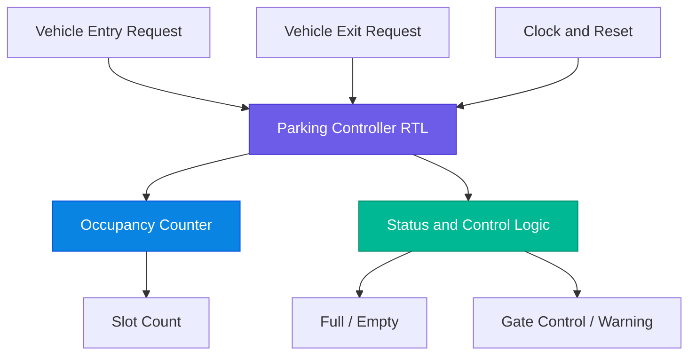

# 🚗 Four-Slot Smart Parking Controller ASIC

<p align="center">
  
  
  
  
</p>

<p align="center">
  <b>RTL Design → Functional Verification → Synthesis → Physical Design → Timing Analysis</b>
</p>

<p align="center">
  A small-scale digital parking controller taken through an ASIC implementation workflow using open-source EDA tools and the SKY130 HD standard-cell library.
</p>

---

## 💡 About the Project

**What if a parking controller could be designed as a real digital hardware circuit?**

The Four-Slot Smart Parking Controller is a Verilog-based digital system that manages parking occupancy for up to four vehicles. It processes vehicle entry and exit requests, maintains the slot count, and generates status signals based on the current parking state.

This project goes beyond writing RTL. It explores the journey from a hardware description to a technology-mapped netlist, physical implementation, timing reports, and GDSII layout.

> 🎯 **Project Focus:** Small digital ASIC design, SKY130 HD implementation, and multi-corner static timing analysis.

## ✨ Key Features

| Feature | Description |
|:--|:--|
| 🚘 Four-slot capacity | Tracks occupancy for a parking area with four spaces |
| 🔄 Entry/exit control | Processes vehicle entry and exit requests |
| 🔢 Occupancy tracking | Reports the current occupied-slot count |
| 🚦 Status generation | Provides full, empty, gate-control, and warning outputs |
| 🧪 RTL verification | Uses Verilog testbenches and simulation waveforms |
| ⚙️ Logic synthesis | Synthesizes the design and maps it to SKY130 HD cells |
| 🏗️ Physical implementation | Covers floorplanning, placement, CTS, and routing |
| ⏱️ Multi-corner STA | Evaluates setup and minimum-path timing at TT, SS, and FF corners |
| 🧩 Layout generation | Produces a GDSII layout through the ASIC flow |

## 🏛️ System Architecture



The architecture represents the digital control logic. External sensors, a physical gate motor, and a real parking installation are not included in the current RTL design.

## 🔧 Design Specifications

<table>
  <tr><th align="left">Parameter</th><th align="left">Details</th></tr>
  <tr><td>Design name</td><td><code>parking_controller</code></td></tr>
  <tr><td>Design category</td><td>Digital control / ASIC implementation</td></tr>
  <tr><td>HDL</td><td>Verilog</td></tr>
  <tr><td>Parking capacity</td><td>4 vehicles</td></tr>
  <tr><td>Inputs</td><td><code>clk</code>, <code>reset</code>, <code>entry</code>, <code>exit</code></td></tr>
  <tr><td>Outputs</td><td><code>gate_open</code>, <code>full</code>, <code>empty</code>, <code>slot_count</code>, <code>warning</code></td></tr>
  <tr><td>Standard-cell library</td><td>SKY130 HD</td></tr>
  <tr><td>Clock constraint</td><td>10 ns (100 MHz target)</td></tr>
  <tr><td>Clock uncertainty</td><td>0.2 ns</td></tr>
  <tr><td>Implementation flow</td><td>OpenLane</td></tr>
  <tr><td>Timing analysis</td><td>OpenSTA</td></tr>
</table>

## 🛠️ EDA Tools & Technologies

<p>
  
  
  
  
  
  
  
</p>

| Tool | Purpose |
|:--|:--|
| Icarus Verilog | RTL and testbench simulation |
| GTKWave | Waveform inspection |
| Yosys | Logic synthesis and technology mapping |
| OpenLane | Automated ASIC physical-design flow |
| OpenSTA | Static timing analysis |
| Magic / layout viewers | Layout inspection and physical verification, where applicable |

## 🔁 ASIC Implementation Workflow


## ⏱️ Multi-Corner Static Timing Analysis

Timing analysis helps determine whether the design meets its timing constraints under different process, voltage, and temperature conditions.

| Corner | Operating condition | Purpose |
|:--|:--|:--|
| 🟢 TT | 25°C, 1.80 V | Typical operating condition |
| 🔵 SS | 100°C, 1.60 V | Slow-process timing evaluation |
| 🟠 FF | −40°C, 1.95 V | Fast-process timing and minimum-path evaluation |

### 📊 Verified Post-Route Timing Summary

The following values are taken from the detailed project STA logs. The hold-related column reports the smallest observed minimum-path-related slack, including relevant reset timing checks; it should not be confused with register-to-register hold slack alone.

| Metric | TT | SS | FF |
|:--|--:|--:|--:|
| Worst setup slack | +7.619 ns | +6.247 ns | +8.084 ns |
| Worst minimum-path-related slack | +0.374 ns | +0.407 ns | +0.150 ns |
| Total negative slack (TNS) | 0.00 ns | 0.00 ns | 0.00 ns |

**Timing observations**

- The SS corner has the lowest reported setup slack among these three corners.
- The FF corner has the smallest reported minimum-path-related slack.
- TNS is reported as zero for all three corners in the analyzed reports.
- Final conclusions should be checked against timing coverage, constraints, and tool warnings.

> ⚠️ These are project-reported timing results, not a claim of silicon validation. Liberty warnings and timing coverage should be reviewed before treating the analysis as sign-off quality.

## 📂 Repository Structure

```text
Four-Slot-Smart-Parking-ASIC/
│
├── README.md
├── rtl/
│   └── parking_controller.v
├── tb/
│   ├── tb_parking_controller.v
│   └── tb_parking_gls.v
├── constraints/
│   └── parking_controller.sdc
├── sta/
│   ├── parking_controller_postroute_sta.tcl
│   ├── parking_controller_postroute_ss.tcl
│   └── parking_controller_postroute_ff.tcl
├── reports/
│   ├── multicorner_sta_verified_summary.txt
│   ├── postroute_tt_sta.log
│   ├── postroute_ss_sta.log
│   ├── postroute_ff_sta.log
│   └── graphs/
└── physical_design/
    └── images/
```

*The structure above describes the intended documentation layout. Add only files that exist in the repository, and update filenames to match the actual uploaded files.*

## 📈 Project Deliverables

- Verilog RTL source code.
- Functional and gate-level testbenches.
- Simulation waveforms and verification results.
- Synthesized netlist and synthesis reports.
- Physical-design stage reports and layout screenshots.
- Multi-corner STA scripts, logs, and graphs.
- GDSII layout and applicable physical verification reports.

## 🚀 Future Enhancements

- Interface with real parking sensors.
- Add a display for available parking spaces.
- Integrate a gate-driver interface and external control hardware.
- Add fault handling and improved request validation.
- Explore power, performance, and area (PPA) optimization.

## 🎓 Skills Demonstrated

`Verilog RTL` · `Functional Verification` · `Logic Synthesis` · `SKY130 HD` · `OpenLane` · `OpenSTA` · `Static Timing Analysis` · `PVT Corner Analysis` · `ASIC Physical Design` · `GDSII`

## 🏁 Conclusion

The Four-Slot Smart Parking Controller ASIC demonstrates a practical digital-design workflow from Verilog RTL to physical implementation. It combines functional verification, standard-cell synthesis, physical-design stages, and multi-corner timing evaluation in a compact hardware project.

The project provides hands-on experience with the tools and reports used to understand how a digital design behaves before fabrication.

---

<p align="center">
  <b>Designed with Verilog HDL | Implemented with Open-Source ASIC Tools</b>
  <br/>
  <sub>Four-Slot Smart Parking Controller ASIC · SKY130 HD</sub>
</p>
