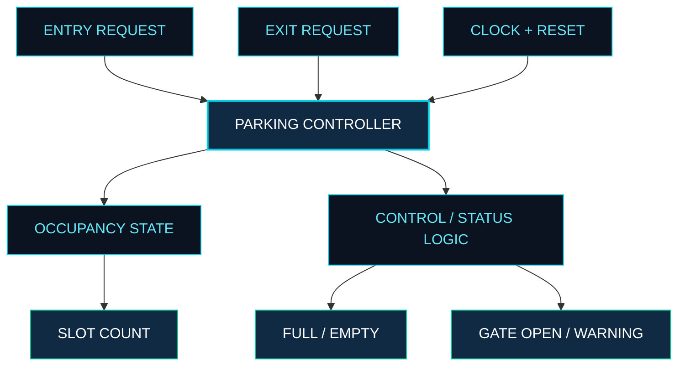

# ⬡ FOUR-SLOT SMART PARKING CONTROLLER ASIC

<p align="center">
  
  
  
  
</p>

<p align="center">
  <b>DESIGN IT. VERIFY IT. SYNTHESIZE IT. IMPLEMENT IT.</b>
  <br/>
  <sub>A digital hardware project exploring the journey from Verilog RTL to ASIC physical implementation.</sub>
</p>

---

## 01 / PROJECT OVERVIEW

A parking controller is a small application with a meaningful hardware-design challenge: tracking occupancy, processing entry and exit requests, and generating reliable control signals.

This project implements a **four-slot parking controller in Verilog HDL** and takes the design through simulation, logic synthesis, physical implementation, and static timing analysis using the **SKY130 High-Density (HD) standard-cell library**.

The focus is not only on the controller's logic, but also on understanding how RTL becomes a technology-mapped circuit and how its timing is evaluated after physical implementation.

<p align="center">
  
  
  
</p>

## 02 / DESIGN SPECIFICATION

| Parameter | Implementation |
|:--|:--|
| Design module | `parking_controller` |
| Design type | Synchronous digital controller |
| RTL language | Verilog HDL |
| Parking capacity | 4 vehicles |
| Inputs | `clk`, `reset`, `entry`, `exit` |
| Outputs | `gate_open`, `full`, `empty`, `slot_count`, `warning` |
| Target technology | SKY130 HD |
| Clock constraint | 10 ns (100 MHz target) |
| Clock uncertainty | 0.2 ns |
| Physical-design flow | OpenLane |
| Timing analysis | OpenSTA |

## 03 / FUNCTIONAL ARCHITECTURE

The controller processes entry and exit requests using clocked digital logic. Its occupancy state drives status outputs indicating whether the parking area is full or empty and provides the current slot count.



**Design boundary:** The current RTL models the digital controller. Physical vehicle sensors, a motorized gate, and a complete parking installation are not part of the implemented design.

## 04 / RTL-TO-GDSII IMPLEMENTATION FLOW

The design is developed and evaluated through a sequence of digital implementation stages.

```mermaid
flowchart LR
    A["01<br/>Verilog RTL"] --> B["02<br/>Simulation"]
    B --> C["03<br/>Synthesis"]
    C --> D["04<br/>Floorplan"]
    D --> E["05<br/>Placement"]
    E --> F["06<br/>CTS"]
    F --> G["07<br/>Routing"]
    G --> H["08<br/>Post-route STA"]
    H --> I["09<br/>GDSII"]

    style A fill:#0B1220,color:#67E8F9,stroke:#00CFE8
    style B fill:#0B1220,color:#67E8F9,stroke:#00CFE8
    style C fill:#0B1220,color:#67E8F9,stroke:#00CFE8
    style D fill:#102A43,color:#FFFFFF,stroke:#00CFE8
    style E fill:#102A43,color:#FFFFFF,stroke:#00CFE8
    style F fill:#102A43,color:#FFFFFF,stroke:#00CFE8
    style G fill:#102A43,color:#FFFFFF,stroke:#00CFE8
    style H fill:#064E3B,color:#FFFFFF,stroke:#00C896,stroke-width:2px
    style I fill:#064E3B,color:#FFFFFF,stroke:#00C896
```



| Stage | Purpose | Tool / technology |
|:--|:--|:--|
| RTL development | Describe controller behavior | Verilog HDL |
| Functional simulation | Exercise the RTL with testbench inputs | Icarus Verilog |
| Waveform inspection | Inspect signal transitions | GTKWave |
| Logic synthesis | Convert RTL to a gate-level netlist | Yosys |
| Technology mapping | Map logic to standard cells | SKY130 HD library |
| Physical implementation | Floorplanning, placement, CTS, and routing | OpenLane |
| Static timing analysis | Evaluate setup and minimum-path timing | OpenSTA |
| Layout output | Generate the physical layout database | GDSII flow |

## 05 / MULTI-CORNER STATIC TIMING ANALYSIS

A circuit's timing behavior varies with process characteristics, supply voltage, and temperature. Multi-corner STA evaluates the design under different operating conditions instead of relying on a single typical corner.

### Analysis conditions

| Corner | Process / temperature / voltage | Analysis focus |
|:--|:--|:--|
| TT | Typical, 25°C, 1.80 V | Typical timing behavior |
| SS | Slow, 100°C, 1.60 V | Slower-path timing evaluation |
| FF | Fast, −40°C, 1.95 V | Fast-path and minimum-delay evaluation |

### Detailed post-route results

The following values are taken from the detailed post-route STA logs in the project.

| Timing metric | TT | SS | FF |
|:--|--:|--:|--:|
| Worst setup slack | +7.619 ns | +6.247 ns | +8.084 ns |
| Worst minimum-path-related slack | +0.374 ns | +0.407 ns | +0.150 ns |
| Total negative slack (TNS) | 0.00 ns | 0.00 ns | 0.00 ns |

<p align="center">
  
  
</p>

### What the results indicate

- **SS has the lowest reported setup slack** of the three analyzed corners.
- **FF has the smallest reported minimum-path-related slack**, making minimum-delay checks important.
- The detailed logs report **TNS = 0.00 ns** at all three corners.
- The reported minimum-path-related slack includes relevant minimum-path and reset timing checks; it is not necessarily the same as register-to-register hold slack alone.

> **Timing qualification:** These results are from the available project logs, not silicon measurements or a claim of sign-off-quality timing closure. The logs contain tool warnings that should be reviewed, and timing coverage and constraints must be checked before drawing final sign-off conclusions.

## 06 / TOOLS & TECHNOLOGY STACK

<p align="center">
  
  
  
  
  
  
  
</p>

- **Verilog HDL:** RTL implementation of the parking controller.
- **Icarus Verilog and GTKWave:** Simulation and waveform analysis.
- **Yosys:** Logic synthesis and netlist generation.
- **OpenLane:** ASIC physical-design automation.
- **OpenSTA:** Static timing analysis across operating corners.
- **SKY130 HD:** Standard-cell technology library used by the design flow.

## 07 / PROJECT FILE ORGANIZATION

```text
Four-Slot-Smart-Parking-ASIC/
├── README.md
├── rtl/
│   └── parking_controller.v
├── tb/
│   ├── tb_parking_controller.v
│   └── tb_parking_gls.v
├── constraints/
│   └── parking_controller.sdc
├── sta/
│   ├── parking_controller_postroute_sta.tcl
│   ├── parking_controller_postroute_ss.tcl
│   └── parking_controller_postroute_ff.tcl
├── reports/
│   ├── multicorner_sta_verified_summary.txt
│   ├── postroute_tt_sta.log
│   ├── postroute_ss_sta.log
│   ├── postroute_ff_sta.log
│   └── graphs/
└── physical_design/
    └── images/
```

*This is the intended documentation structure. Include only files that are actually present in the repository, and adjust paths to match the uploaded project.*

## 08 / ENGINEERING DELIVERABLES

The project deliverables cover the design and implementation evidence needed to inspect the controller:

- Verilog RTL and simulation testbenches.
- Functional and gate-level simulation logs.
- Synthesized netlist and synthesis reports.
- OpenLane physical-design outputs and stage reports.
- OpenSTA scripts and detailed TT, SS, and FF timing logs.
- Timing summary and graphs generated from verified report values.
- GDSII layout and applicable physical verification results.

## 09 / SCOPE & FUTURE EXTENSIONS

The current implementation focuses on the **digital controller and its ASIC design flow**. The following are possible extensions, not claimed features of the current RTL:

- Interface with physical vehicle-detection sensors.
- Add a display for available parking slots.
- Integrate a gate-driver interface and external hardware.
- Add fault handling and expanded request validation.
- Explore power, performance, and area optimization.

## 10 / PROJECT SUMMARY

This project demonstrates the implementation of a compact digital controller through an ASIC-oriented workflow. It combines RTL design, functional verification, standard-cell synthesis, physical implementation, and multi-corner static timing analysis using open-source EDA tools and the SKY130 HD technology library.

The emphasis is on connecting **functional correctness, physical implementation, and timing evaluation** within one documented hardware project.

---

<p align="center">
  <b>FOUR-SLOT SMART PARKING CONTROLLER</b>
  <br/>
  <sub>VERILOG RTL &nbsp;|&nbsp; SKY130 HD &nbsp;|&nbsp; OPENLANE &nbsp;|&nbsp; OPENSTA</sub>
</p>
