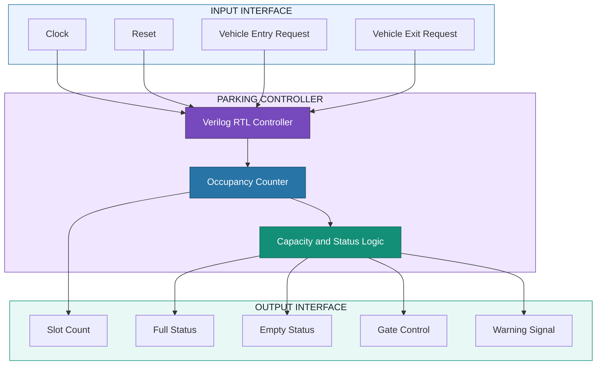
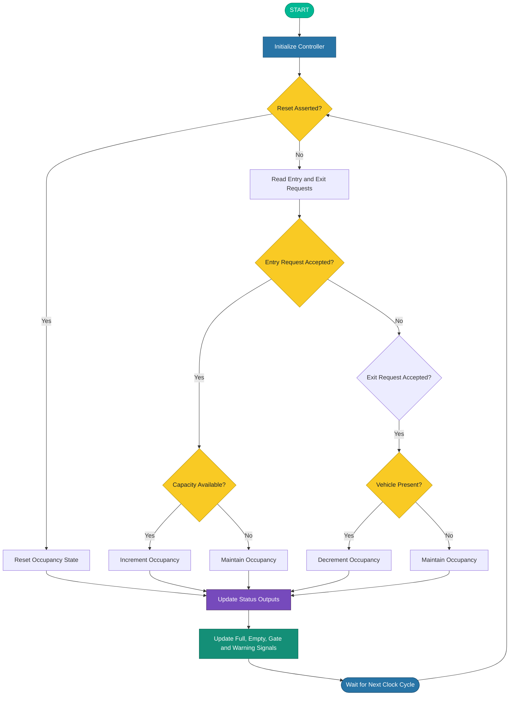

# 🚗 Four-Slot Smart Parking Controller ASIC

<p align="center">
  
  
  
  
</p>

<p align="center">
  <b>RTL Design → Functional Verification → Synthesis → Physical Design → Timing Analysis</b>
</p>

<p align="center">
  A digital parking controller implemented using Verilog HDL and explored through an open-source ASIC design flow.
</p>

---

## 💡 1. Project Overview

The **Four-Slot Smart Parking Controller ASIC** is a Verilog-based digital hardware design that manages parking occupancy for a maximum of four vehicles. It processes vehicle entry and exit requests, tracks the number of occupied slots, and generates status and control signals based on the current parking state.

This project explores the journey from Register Transfer Level (RTL) design to logic synthesis, standard-cell technology mapping, physical design, static timing analysis, and GDSII layout generation using the SKY130 High-Density (HD) standard-cell library.

The primary objective is to understand how a small digital controller can be designed, verified, synthesized, physically implemented, and evaluated using open-source Electronic Design Automation (EDA) tools.

> 🎯 **Project Focus:** Digital RTL design, ASIC physical implementation, and multi-corner static timing analysis.

## ✨ 2. Key Features

| Feature | Description |
|:--|:--|
| 🚘 Four-slot capacity | Manages occupancy for a parking area with four spaces |
| 🔄 Entry/exit control | Processes vehicle entry and exit requests |
| 🔢 Occupancy tracking | Reports the current occupied-slot count |
| 🚦 Status generation | Produces full, empty, gate-control, and warning signals |
| 🧪 RTL verification | Uses testbenches and simulation waveforms |
| ⚙️ Logic synthesis | Synthesizes the design using Yosys |
| 🧩 Technology mapping | Targets SKY130 HD standard cells |
| 🏗️ Physical implementation | Covers floorplanning, placement, CTS, and routing |
| ⏱️ Multi-corner STA | Evaluates timing under TT, SS, and FF conditions |
| 💾 Layout generation | Produces a GDSII layout through the ASIC flow |

## 🧩 3. System Block Diagram



### Block Diagram Explanation

- **Input Interface:** Receives clock, reset, entry, and exit signals.
- **RTL Controller:** Coordinates the digital parking-control operations.
- **Occupancy Counter:** Tracks the occupied parking slots.
- **Capacity and Status Logic:** Determines parking status and control outputs.
- **Output Interface:** Provides slot count, full, empty, gate-control, and warning signals.

The diagram represents the intended logical organization of the controller. The actual implementation details should be verified against the RTL source code.

## 📋 4. Design Specifications

<table>
  <tr><th align="left">Parameter</th><th align="left">Details</th></tr>
  <tr><td>Design name</td><td><code>parking_controller</code></td></tr>
  <tr><td>Design type</td><td>Digital parking control logic</td></tr>
  <tr><td>Hardware description language</td><td>Verilog HDL</td></tr>
  <tr><td>Maximum parking capacity</td><td>4 vehicles</td></tr>
  <tr><td>Inputs</td><td><code>clk</code>, <code>reset</code>, <code>entry</code>, <code>exit</code></td></tr>
  <tr><td>Outputs</td><td><code>gate_open</code>, <code>full</code>, <code>empty</code>, <code>slot_count</code>, <code>warning</code></td></tr>
  <tr><td>Standard-cell library</td><td>SKY130 HD</td></tr>
  <tr><td>Clock period constraint</td><td>10 ns (100 MHz target)</td></tr>
  <tr><td>Clock uncertainty</td><td>0.2 ns</td></tr>
  <tr><td>ASIC implementation flow</td><td>OpenLane</td></tr>
  <tr><td>Static timing analysis</td><td>OpenSTA</td></tr>
  <tr><td>Layout output format</td><td>GDSII</td></tr>
</table>

## 🧠 5. Algorithm

The controller follows a clocked digital control algorithm.

### Step-by-Step Procedure

1. Start the controller.
2. Wait for the active clock edge.
3. Check whether reset is asserted.
4. If reset is asserted, initialize the occupancy state according to the RTL reset logic.
5. Otherwise, read the entry and exit requests.
6. Process an accepted entry request when parking capacity is available.
7. Process an accepted exit request when at least one vehicle is present.
8. Update the occupancy state according to the implemented control logic.
9. Generate the full and empty status signals based on occupancy.
10. Generate gate-control and warning outputs according to the RTL conditions.
11. Repeat the process during subsequent clock cycles.

### Algorithm Pseudocode

```text
START

Initialize the controller using reset

REPEAT on every active clock edge:

    IF reset is asserted:
        Initialize occupancy state
    ELSE:
        Read entry and exit requests
        Process requests according to RTL control logic
        Update occupancy within supported capacity

    Update:
        slot_count
        full
        empty
        gate_open
        warning

UNTIL operation stops

END
```

**Note:** Simultaneous entry and exit requests must be handled according to the priority implemented in the actual RTL. The pseudocode describes the general algorithm and does not assume an unverified priority rule.

## 🔄 6. Parking Controller Flowchart



The flowchart illustrates the general entry/exit processing sequence. Before final submission, confirm that the decision order, reset behavior, and output-update conditions match the actual RTL implementation.

## 🛠️ 7. EDA Tools and Technologies

<p>
  
  
  
  
  
  
  
</p>

| Tool / Technology | Purpose |
|:--|:--|
| Verilog HDL | RTL design |
| Icarus Verilog | Functional simulation |
| GTKWave | Waveform visualization |
| Yosys | Logic synthesis and technology mapping |
| OpenLane | Automated ASIC physical-design flow |
| OpenSTA | Static timing analysis |
| SKY130 HD PDK | Standard-cell library and process design kit |
| Magic / layout viewers | Layout inspection and physical verification, where applicable |

## 🏗️ 8. ASIC Implementation Workflow


### Implementation Stages

1. **RTL Design:** Develop the controller using Verilog HDL.
2. **Functional Verification:** Test the design using simulation and testbenches.
3. **Logic Synthesis:** Convert RTL into a synthesized gate-level representation.
4. **Technology Mapping:** Map logic to SKY130 HD standard cells.
5. **Floorplanning:** Define the initial physical organization of the design.
6. **Placement:** Position standard cells within the floorplan.
7. **Clock Tree Synthesis (CTS):** Build the clock distribution network.
8. **Routing:** Connect cells through physical interconnects.
9. **Static Timing Analysis:** Evaluate setup and hold timing.
10. **GDSII Generation:** Generate the layout output through the implementation flow.

## ⏱️ 9. Multi-Corner Static Timing Analysis

Static timing analysis evaluates whether the implemented circuit satisfies the timing constraints under different process, voltage, and temperature (PVT) conditions.

### Operating Corners

| Corner | Operating Condition | Analysis Purpose |
|:--|:--|:--|
| 🟢 TT | 25°C, 1.80 V | Typical operating conditions |
| 🔵 SS | 100°C, 1.60 V | Slow-process timing evaluation |
| 🟠 FF | −40°C, 1.95 V | Fast-process and minimum-path evaluation |

### 📊 Post-Route Timing Summary

The following values are taken from the detailed project STA logs.

| Metric | TT | SS | FF |
|:--|--:|--:|--:|
| Worst setup slack | +7.619 ns | +6.247 ns | +8.084 ns |
| Worst minimum-path-related slack | +0.374 ns | +0.407 ns | +0.150 ns |
| Total negative slack (TNS) | 0.00 ns | 0.00 ns | 0.00 ns |

### Timing Observations

- **Setup:** The SS corner has the lowest reported setup slack among the three analyzed corners.
- **Minimum-path timing:** The FF corner has the smallest reported minimum-path-related slack.
- **TNS:** The analyzed reports show zero total negative slack at all three corners.
- **Further review:** Timing coverage, constraints, path types, and tool warnings should be reviewed before drawing sign-off conclusions.

> ⚠️ **Important:** The minimum-path-related slack column represents the smallest observed minimum-path-related timing check, including relevant reset timing checks. It should not be interpreted as register-to-register hold slack alone. These are tool-reported results, not silicon validation or a claim of fabrication readiness.

### Timing Metrics Explained

- **Setup Slack:** Indicates the margin available for data to arrive before the required setup time.
- **Hold Slack:** Indicates the margin available to satisfy hold-time requirements.
- **Worst Slack:** The smallest slack for the timing-check category being reported.
- **TNS:** Total negative slack across violating paths; zero TNS means no negative slack was reported for the included checks.

*This is the intended documentation structure. Upload the actual files and adjust filenames to match the contents of the repository.*

## 📦 Project Deliverables

- Verilog RTL source code.
- Functional and gate-level simulation testbenches.
- Simulation waveforms and verification logs.
- Synthesized gate-level netlist.
- Physical-design reports and stage screenshots.
- Multi-corner STA scripts, logs, summaries, and graphs.
- GDSII layout and applicable physical verification reports.

## 🚀 10. Future Enhancements

The current project focuses on the digital control logic. The following enhancements could extend it toward a practical smart parking system.

- **🚘 Real-Time Vehicle Detection:** Integrate external sensors to detect vehicle entry and exit.
- **📟 Slot Availability Display:** Add an LCD or seven-segment display to show parking availability.
- **🚪 Automated Gate Interface:** Connect an appropriate external gate-driver interface.
- **🔔 Alert Mechanism:** Add audible or visual alerts when the parking area is full.
- **🛡️ Improved Safety Logic:** Introduce fault detection, invalid-request handling, and robust reset behavior.
- **⚡ PPA Optimization:** Explore power, performance, and area improvements.
- **📊 Enhanced Timing Analysis:** Investigate critical timing paths, timing coverage, and additional PVT conditions.
- **🧪 Extended Verification:** Add boundary-condition tests, assertions, and more comprehensive test scenarios.

These are proposed future enhancements and are not features claimed for the current RTL implementation.

## 🎓 11. Skills Demonstrated

This project provides hands-on exposure to digital design and ASIC implementation concepts.

| Skill Area | Knowledge Demonstrated |
|:--|:--|
| 💻 RTL Design | Verilog modules and sequential control logic |
| 🧪 Functional Verification | Testbench development and simulation |
| 📈 Waveform Analysis | Signal inspection using GTKWave |
| ⚙️ Logic Synthesis | Synthesis using Yosys |
| 🧩 Technology Mapping | SKY130 HD standard-cell mapping |
| 🏗️ Physical Design | Floorplanning, placement, CTS, and routing |
| ⏱️ Static Timing Analysis | Setup timing, minimum-path timing, slack, and TNS |
| 🌡️ PVT Analysis | Comparing TT, SS, and FF operating corners |
| 📐 Physical Verification | Reviewing available DRC and LVS reports |
| 💾 Layout Generation | Working with the GDSII format |
| 📝 Technical Documentation | Organizing source files, scripts, reports, and results |

## 🏁 12. Conclusion

The **Four-Slot Smart Parking Controller ASIC** demonstrates a practical digital hardware design workflow using Verilog HDL and open-source EDA tools.

The project connects RTL development and functional verification with logic synthesis, SKY130 HD technology mapping, physical-design stages, and multi-corner static timing analysis. It also provides experience in interpreting timing reports, reviewing implementation results, and documenting a digital design from RTL toward physical layout.

The project establishes a foundation for further exploration of ASIC design, timing optimization, verification, and hardware integration.

> 💡 **Key Takeaway:** A digital hardware design must be functionally verified, synthesized, physically implemented, and carefully evaluated before it can be considered ready for fabrication.

---

<p align="center">
  <b>🚗 Four-Slot Smart Parking Controller ASIC</b>
  <br/>
  <i>Designed with Verilog HDL · Implemented using Open-Source ASIC Tools · Evaluated with Multi-Corner STA</i>
</p>
