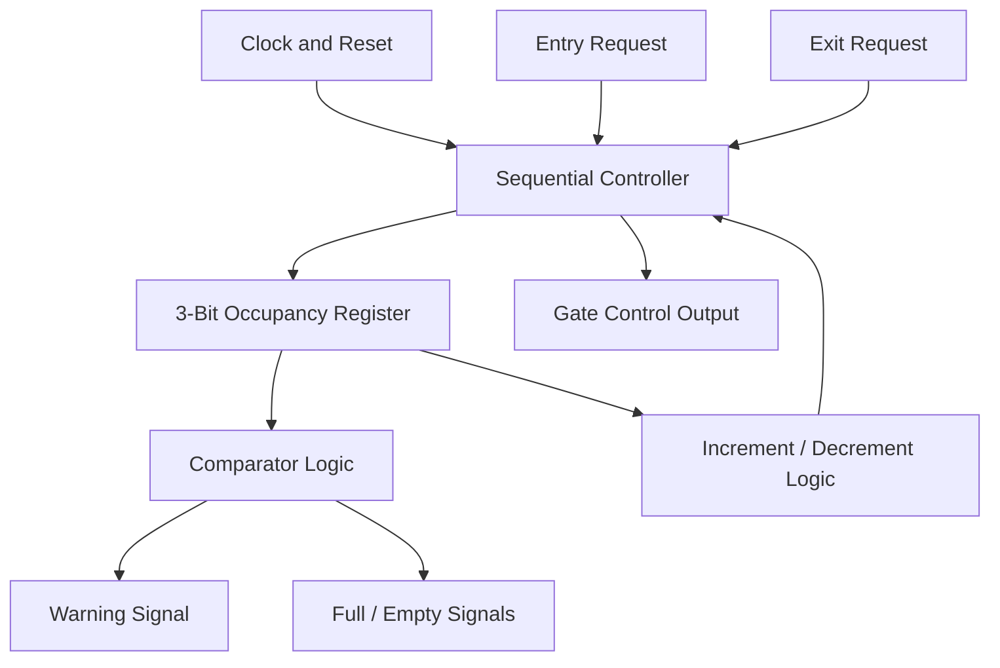
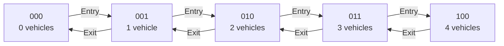
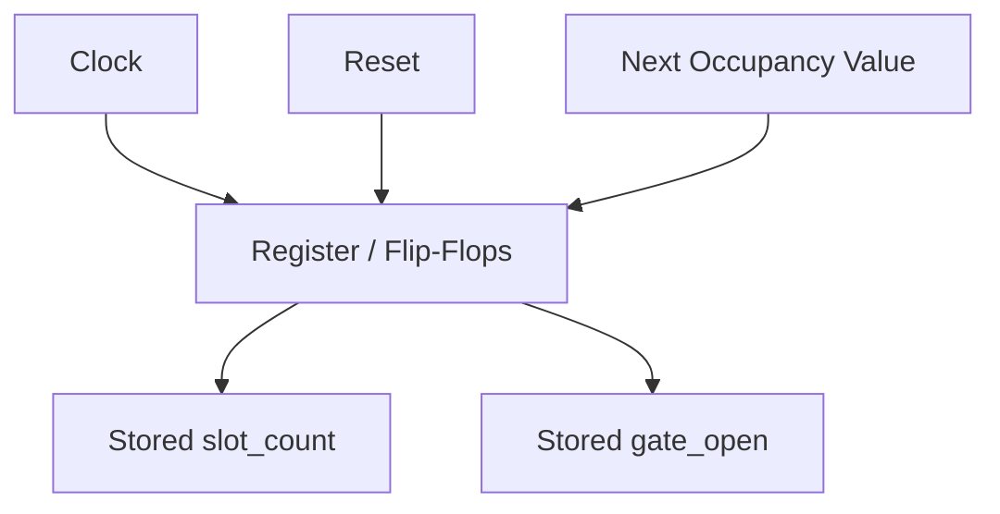
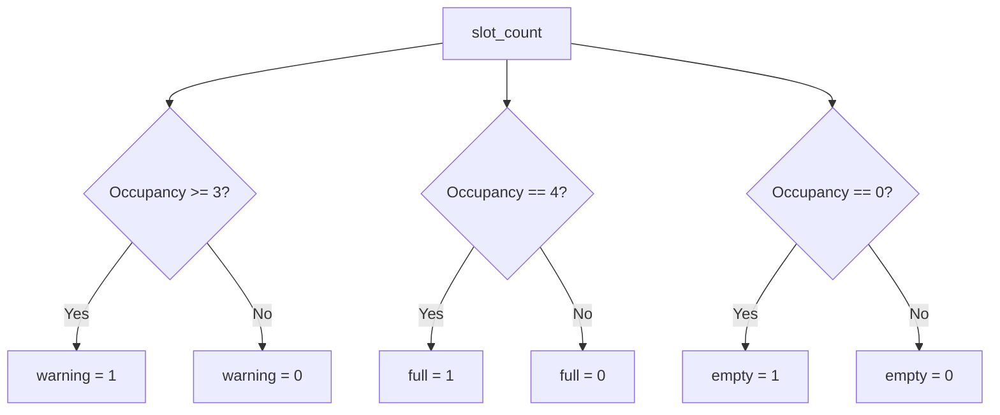
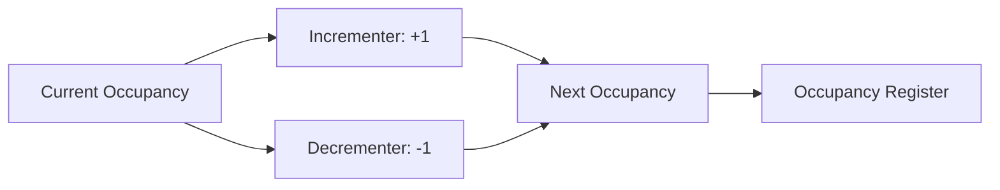
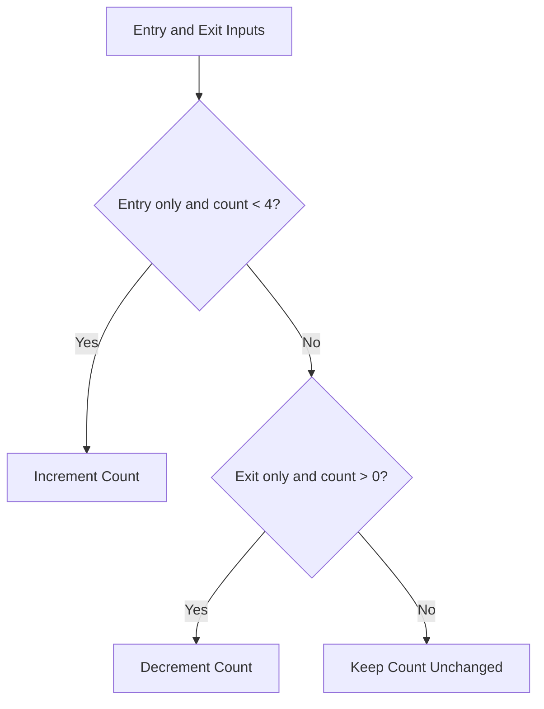
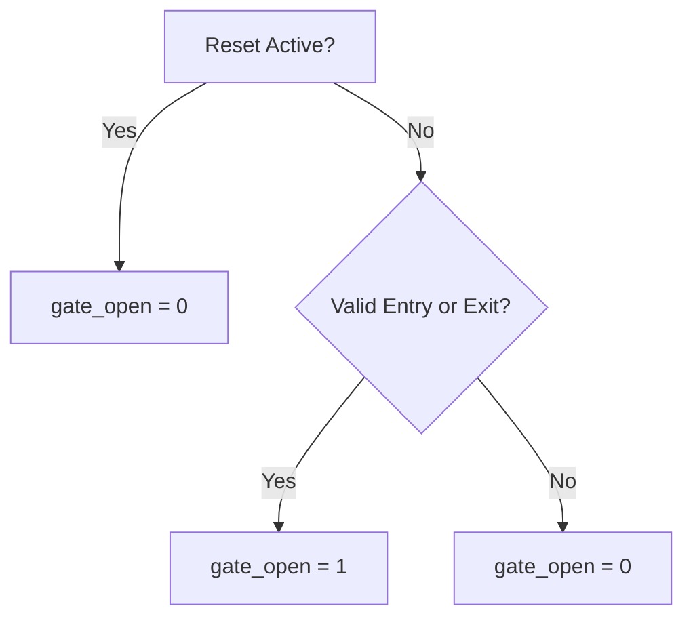

# Four-Slot Smart Parking Occupancy and Gate Controller ASIC

## 1. Introduction

The Four-Slot Smart Parking Occupancy and Gate Controller ASIC is a digital hardware design developed to manage vehicle parking occupancy in a small parking area with a maximum capacity of four vehicles. The project uses Verilog HDL to implement a controller that tracks occupied parking slots, processes vehicle entry and exit requests, and generates parking status and gate-control signals.

The design demonstrates how a real-world parking management function can be implemented at the Register Transfer Level (RTL) and taken through an Application-Specific Integrated Circuit (ASIC) design flow. The design is simulated and synthesized, followed by physical-design implementation and timing analysis using the SKY130 standard-cell platform and open-source VLSI tools.

This project provides practical experience in digital logic design, RTL coding, functional verification, logic synthesis, physical design, and static timing analysis.

## 2. Project Description

The proposed system is designed to manage a parking area containing four parking slots. It maintains a digital count of occupied slots and updates this count based on vehicle entry and exit requests.

When a valid vehicle entry request is received, the controller updates the occupancy count if parking capacity is available. When a valid exit request is received, the count decreases if at least one vehicle is parked. The controller also generates status signals to indicate whether the parking area is full or empty and provides a gate-control output according to the implemented control logic.

The design is written in Verilog HDL and verified using a testbench that applies different input sequences, including reset, entry, and exit operations. After functional verification, the RTL can be synthesized into a standard-cell netlist and processed through the ASIC physical-design flow.

The project uses the SKY130 HD standard-cell library and tools such as Icarus Verilog, GTKWave, Yosys, OpenLane, OpenROAD, and OpenSTA for simulation, waveform inspection, synthesis, physical design, and timing analysis.

### 2.1 Main Features

- Four-slot parking occupancy tracking.
- Vehicle entry and exit request processing.
- Full and empty parking status generation.
- Gate-control signal generation.
- Verilog RTL implementation and testbench verification.
- ASIC synthesis and physical-design implementation.
- Static timing analysis across selected process, voltage, and temperature (PVT) corners.

### 2.2 Project Scope

This project implements the **digital parking controller**, not a complete physical parking installation. Real vehicle sensors, a gate motor, and an external display or monitoring system would require additional hardware and interface integration.

## 3. Real-World Applications

### 3.1 Small Residential Parking Areas

The controller can be adapted for small apartment parking areas with a limited number of parking spaces. It tracks occupied slots and indicates when the configured parking capacity is reached.

### 3.2 Office and Campus Parking

Small offices, laboratories, and campus parking areas can use similar occupancy-control logic to monitor the number of vehicles inside a designated parking zone.

### 3.3 Parking Gate Automation

The `gate_open` output can act as a digital command signal for an external gate-control interface. A suitable motor driver, safety sensors, and gate mechanism would be required for physical gate operation.

### 3.4 Parking Occupancy Indicators

The `full`, `empty`, and `warning` outputs can be connected to external indicator circuits or a monitoring controller to display parking availability.

### 3.5 Embedded Systems and IoT Integration

The controller can be integrated with a microcontroller or communication interface to share occupancy information with a monitoring system. Communication and networking functionality are not implemented in the current RTL.

### 3.6 ASIC and VLSI Design Education

The project demonstrates practical digital-design concepts, including counters, registers, comparators, combinational control logic, and sequential circuits. It also provides experience with simulation, synthesis, physical design, and static timing analysis.

### 3.7 Scalable Parking Management Systems

The four-slot controller can serve as a reference architecture for designing larger-capacity systems. Increasing the capacity would require appropriate counter sizing, updated status comparisons, and additional verification.

## 4. Benefits

- Tracks parking occupancy digitally.
- Prevents the occupancy count from exceeding the configured capacity.
- Generates full, empty, and early-warning status signals.
- Provides a gate-control output for external hardware integration.
- Demonstrates an end-to-end ASIC design workflow.
- Offers a foundation for future expansion and system integration.

##  4.Digital Logical Circuits Used


The **Four-Slot Smart Parking Occupancy and Gate Controller ASIC** uses sequential and combinational digital logic to track parking occupancy, process vehicle entry and exit requests, and generate parking status and gate-control signals.

## 1. Overall Digital Controller Architecture

The following diagram illustrates the main inputs, controller logic, and outputs.



## 2. 3-Bit Occupancy Counter

The `slot_count` register stores the number of occupied slots from zero to four.

```verilog
output reg [2:0] slot_count;
```

### Binary Representation

| Occupied Slots | Binary Value |
|---:|:---:|
| 0 | `000` |
| 1 | `001` |
| 2 | `010` |
| 3 | `011` |
| 4 | `100` |



The counter increases on a valid entry and decreases on a valid exit. Entry is blocked when occupancy is four, and exit is blocked when occupancy is zero.

## 3. Registers and Flip-Flops

The controller uses clocked sequential logic to store the occupancy count and gate-control output.

```verilog
always @(posedge clk or posedge reset)
```



- `posedge clk` updates registers at the rising clock edge.
- `posedge reset` resets the stored values asynchronously.
- The occupancy count and gate output are reset to zero.

## 4. Comparator Logic

The controller compares the occupancy count with specific values to generate status outputs.

```verilog
assign warning = (slot_count >= 3);
assign full    = (slot_count == 4);
assign empty   = (slot_count == 0);
```



| Condition | Output |
|---|---|
| Occupancy is 3 or more | `warning = 1` |
| Occupancy equals 4 | `full = 1` |
| Occupancy equals 0 | `empty = 1` |

## 5. Incrementer and Decrementer

The arithmetic logic updates the occupancy counter.

```verilog
slot_count <= slot_count + 1;
slot_count <= slot_count - 1;
```



- **Incrementer:** increases the count for a valid entry.
- **Decrementer:** decreases the count for a valid exit.

## 6. Combinational Control Logic

The following conditions determine whether an entry or exit request is accepted.

```verilog
if (entry && !exit && (slot_count < 4))
```

```verilog
else if (exit && !entry && (slot_count > 0))
```



Simultaneous entry and exit requests do not update the occupancy count in this implementation.

## 7. Gate-Control Logic

The `gate_open` output is set high for an accepted entry or exit request and cleared during normal operation otherwise.



This output is a digital control signal. A physical gate motor would require additional driver and interface hardware.

 Instead, it uses a counter-based sequential controller with conditional control logic.

## 9. Digital Logic Summary

| Circuit / Concept | Purpose |
|---|---|
| 3-bit counter/register | Tracks occupied parking slots |
| Flip-flops | Store clocked values |
| Asynchronous reset | Initializes the controller |
| Comparators | Generate full, empty, and warning signals |
| Incrementer / decrementer | Update occupancy |
| Boolean control logic | Validate entry and exit requests |
| Gate-control register | Generates the gate command |

## 10. ASIC Implementation

The RTL is synthesized using Yosys and mapped to the SKY130 HD standard-cell library. The ASIC flow then uses OpenLane and OpenROAD for physical-design stages, with OpenSTA used for static timing analysis.

## 5.Tools, Languages and Linux Commands Used

## 1. Programming Languages

Language

Purpose

Verilog HDL

RTL design of the parking controller

Verilog Testbench

Functional verification of the RTL

Tcl

Automation and configuration of synthesis, physical design, and timing analysis

Linux Shell / Bash

Executing commands and managing project files

## 2. Tools Used in the Project

Tool

Purpose

Icarus Verilog

RTL and testbench simulation

GTKWave

Viewing simulation waveforms

Yosys

RTL synthesis and logic optimization

OpenLane

ASIC implementation flow

OpenROAD

Floorplanning, placement, clock-tree synthesis, and routing

OpenSTA

Static timing analysis

Magic

Layout inspection and physical-design visualization

SKY130 HD PDK

Standard-cell library and technology files

## 3. Linux Commands Used

The following commands help navigate directories, inspect RTL files, run simulations, execute synthesis tools, and organize project reports.

## 3.1 Directory Navigation

pwd
ls
ls -lh
cd ~/Desktop/four_slot_smart_parking

pwd — displays the current directory.

ls — lists files and directories.

ls -lh — displays file sizes in a readable format.

cd — changes the working directory.

## 3.2 Inspecting Project Files

find . -maxdepth 3 -type f
cat rtl/parking_controller.v
cat constraints/parking_controller.sdc

find — locates project files.

cat — displays RTL source and timing constraints.

constraints/parking_controller.sdc contains design timing constraints.

## 3.3 Creating and Organizing Directories

mkdir -p reports
mkdir -p synthesis
mkdir -p physical_design/images
mkdir -p sta

mkdir -p — creates directories, including parent directories when necessary.

These commands organize reports, synthesis outputs, physical-design images, and timing-analysis files.

## 3.4 RTL Simulation Using Icarus Verilog

From the project directory, compile the RTL and testbench:

iverilog -g2012 -o simulation.vvp \
  rtl/parking_controller.v \
  tb/tb_parking_controller.v

Run the simulation:

vvp simulation.vvp

View the waveform if the testbench generates a VCD file:

gtkwave parking_controller.vcd

The exact waveform filename depends on the $dumpfile statement in the testbench.

## 3.5 RTL Synthesis Using Yosys

A basic synthesis example is:

yosys

Inside the Yosys prompt:

read_verilog rtl/parking_controller.v
hierarchy -check -top parking_controller
proc
opt
check
stat

read_verilog — reads the RTL source.

hierarchy — checks the top-level design hierarchy.

proc — converts procedural RTL into internal logic.

opt — performs logic optimization.

check — checks for structural problems.

stat — displays synthesis statistics.

This is an illustrative RTL synthesis sequence. Technology mapping to SKY130 requires the appropriate library and synthesis configuration.

Exit Yosys:

exit

## 3.6 OpenLane Physical Design

# RTL Language: Verilog HDL
# Technology: SKY130 HD
# Physical Design Flow: OpenLane v0.21
# Physical Design Engine: OpenROAD

Navigate to the OpenLane installation:

cd ~/Desktop/work/tools/openlane_working_dir/openlane

Inspect the available design directories:

ls designs

A typical OpenLane flow invocation is:

./flow.tcl -design smart_parking

The design name must match the actual OpenLane configuration directory. Your earlier project run used smart_parking; the separate project workspace is four_slot_smart_parking.


OpenLane automates multiple ASIC implementation stages, including synthesis, floorplanning, placement, clock-tree synthesis, routing, and design checks, depending on the configuration and flow version.

## Physical Design Stages and Commands

OpenLane supports interactive execution of individual stages. These Tcl commands are entered inside the OpenLane interactive shell, not directly at the normal Linux terminal. See the OpenLane interactive-mode documentation.

## Start Interactive Mode

./flow.tcl -interactive

Inside the OpenLane Tcl shell:

package require openlane
prep -design smart_parking

Use the appropriate existing run tag or configuration if you need to resume or inspect a particular run.

## Synthesis

run_synthesis

Purpose: Converts RTL into a synthesized gate-level netlist and maps logic to the target standard-cell library.

## Floorplanning and Power Planning

run_floorplan

Purpose: Establishes the core area, placement rows, pin locations, and power-distribution setup according to the design configuration.

## Placement

run_placement

Purpose: Places standard cells within the floorplan and performs placement-related optimization.

## Clock Tree Synthesis (CTS)

run_cts

Purpose: Builds the clock distribution network for sequential cells.

## Routing

run_routing

Purpose: Connects the placed standard cells through the routing layers while observing design rules and routing constraints.

## Physical Verification and Layout Generation

Depending on the configuration, OpenLane provides commands such as:

run_magic
run_magic_drc
run_lvs
run_antenna_check

Purpose:

run_magic — performs Magic-related layout operations in the configured flow.

run_magic_drc — runs a design-rule check using Magic.

run_lvs — checks layout-versus-schematic consistency.

run_antenna_check — checks for antenna-rule violations.

The commands above are available in the documented OpenLane interactive flow, but configuration settings can disable particular stages.

## Physical Design Flow Summary

Stage

Command

Purpose

Synthesis

run_synthesis

Generate the mapped netlist

Floorplanning

run_floorplan

Define the physical floorplan

Placement

run_placement

Place standard cells

CTS

run_cts

Build the clock network

Routing

run_routing

Route signal connections

DRC

run_magic_drc

Check layout design rules

LVS

run_lvs

Compare layout and schematic connectivity.


# Static Timing Analysis (STA)

## 1. Introduction

Static Timing Analysis (STA) verifies whether the digital design satisfies its timing constraints without applying simulation input vectors. This project uses OpenSTA and the SKY130 HD standard-cell library to analyze setup timing, hold timing, slack, and timing violations.

## 2. Tools Used

- **OpenSTA** — static timing analysis.
- **SKY130 HD Liberty files** — standard-cell timing models.
- **Verilog netlist** — synthesized or physically implemented design.
- **SDC** — clock and input/output timing constraints.
- **SPEF** — extracted parasitic information for post-route timing analysis, when available.

## 3. Locate STA Reports

Navigate to the OpenLane directory:

```bash
cd ~/Desktop/work/tools/openlane_working_dir/openlane
```

Find timing reports:

```bash
find designs/smart_parking/runs -type f \
  \( -iname '*sta*' -o -iname '*slack*' -o -iname '*tns*' \)
```

Search for setup and hold timing results:

```bash
grep -R -n -E 'Startpoint:|Endpoint:|slack|wns|tns' \
  designs/smart_parking/runs/
```

## 4. Run OpenSTA

OpenSTA can be launched from the terminal using:

```bash
sta
```

Inside the OpenSTA prompt, load the timing library, mapped netlist, design constraints, and parasitics as applicable.

```tcl
read_liberty path/to/sky130_fd_sc_hd__tt_025C_1v80.lib
read_verilog path/to/parking_controller_sky130.v
link_design parking_controller
read_sdc path/to/parking_controller.sdc
```

For post-route analysis, load the matching parasitic file after linking the design:

```tcl
read_spef path/to/parking_controller.spef
```

The paths and file names must match the actual project outputs. Use the correct Liberty corner and matching parasitics for the analysis being performed.

## 5. Timing Reports

```tcl
report_checks
report_worst_slack
report_tns
```

These reports help inspect timing paths, worst slack, and total negative slack. Command availability can vary with the installed OpenSTA version.

## 6. Timing Concepts

| Metric | Meaning |
|---|---|
| Setup slack | Measures whether data arrives before the required setup time |
| Hold slack | Measures whether data remains stable long enough after the clock edge |
| WNS | Worst negative slack, conventionally the most negative setup slack |
| TNS | Total negative slack across violating setup paths |
| PVT corners | Different process, voltage, and temperature conditions |

Positive slack generally indicates that a checked path meets its timing requirement. Negative slack indicates a timing violation.

## 7. Multi-Corner Timing Analysis

The project can be analyzed at different PVT corners using the corresponding SKY130 HD Liberty files, such as:

- **TT:** Typical process, typical operating conditions.
- **SS:** Slow process corner.
- **FF:** Fast process corner.

The exact voltage and temperature depend on the selected Liberty file. Each corner must use a compatible library and appropriate timing configuration.


## -------------------------- ##


## RTL Design — Four-Slot Smart Parking Occupancy and Gate Controller ASIC

## 1. Introduction

Register Transfer Level (RTL) design is an important stage in digital IC development. It describes the behavior of digital hardware using a Hardware Description Language (HDL), such as Verilog.

In this project, Verilog HDL is used to implement a Four-Slot Smart Parking Occupancy and Gate Controller. The design manages parking occupancy, processes vehicle entry and exit requests, and generates status and gate-control signals.

The RTL is designed to be synthesizable and suitable for functional verification, logic synthesis, and subsequent ASIC physical-design implementation using the SKY130 HD standard-cell platform.

## 2. Design Objective

The primary objective is to develop a compact digital controller that manages a parking area with a maximum capacity of four vehicles.

The controller is designed to:
- Maintain the number of occupied parking slots.
- Accept valid vehicle entry requests when space is available.
- Accept valid vehicle exit requests when at least one vehicle is parked.
- Generate an early-warning signal when three or more slots are occupied.
- Indicate when the parking area is full or empty.
- Generate a gate-control signal for valid entry and exit operations.

## 3. RTL Module Description

**Module name:** `parking_controller`

**Hardware description language:** Verilog HDL

The design uses a 3-bit occupancy register, clocked sequential logic, arithmetic operations, and combinational comparison logic.

### Input Signals

| Signal | Description |
|---|---|
| `clk` | Clock input for sequential operations |
| `reset` | Asynchronous active-high reset |
| `entry` | Vehicle entry request |
| `exit` | Vehicle exit request |

### Output Signals

| Signal | Description |
|---|---|
| `slot_count[2:0]` | Current number of occupied parking slots |
| `warning` | High when occupancy reaches three or more |
| `full` | High when all four slots are occupied |
| `empty` | High when no vehicles are parked |
| `gate_open` | Gate-control output |

## 4. RTL Architecture

The controller consists of the following functional blocks:

1. **Occupancy register:** Stores the number of occupied slots.
2. **Increment and decrement logic:** Updates occupancy after valid entry and exit requests.
3. **Comparator logic:** Generates warning, full, and empty status signals.
4. **Control logic:** Checks entry and exit conditions and controls the gate output.
5. **Reset logic:** Initializes the occupancy count and gate-control output.

## 5. Occupancy Counter Operation

The design uses a 3-bit register to represent parking occupancy.

| Occupancy | Binary value | Status |
|---:|:---:|---|
| 0 | `000` | Empty |
| 1 | `001` | Space available |
| 2 | `010` | Space available |
| 3 | `011` | Warning active |
| 4 | `100` | Full and warning active |

Three bits are sufficient to represent all required occupancy values from zero through four.

## 6. Entry and Exit Control

### Vehicle Entry

When `entry = 1`, `exit = 0`, and `slot_count < 4`, the controller increments the occupancy count and sets `gate_open` to `1`.

If all four slots are occupied, an additional entry request does not increase the count.

### Vehicle Exit

When `exit = 1`, `entry = 0`, and `slot_count > 0`, the controller decrements the occupancy count and sets `gate_open` to `1`.

If the parking area is already empty, an exit request does not decrease the count below zero.

### Simultaneous Requests

When both `entry` and `exit` are asserted, neither request is accepted by the current control logic, and the occupancy count remains unchanged.

## 7. Reset and Sequential Logic

The design uses the following clocked process:

```verilog
always @(posedge clk or posedge reset)
```

The asynchronous, active-high reset initializes:
- `slot_count = 0`
- `gate_open = 0`

During normal operation, the occupancy register and gate-control output are updated according to the clock and input conditions.

## 8. Functional Verification

The RTL is verified using a Verilog testbench.

The testbench applies clock and reset signals and exercises:
- Vehicle entry requests.
- Filling all four parking slots.
- An additional entry request when the parking area is full.
- A vehicle exit request.
- Repeated exit requests near the empty boundary.

Icarus Verilog is used to compile and simulate the design. GTKWave can be used to inspect the generated `parking_rtl.vcd` waveform.

## 9. Synthesis and ASIC Implementation

After functional verification, the RTL can be synthesized using Yosys and mapped to the SKY130 HD standard-cell library.

The design is then processed through the configured OpenLane/OpenROAD physical-design flow. OpenSTA is used to analyze timing using the relevant constraints, libraries, and parasitic data.

## RTL Design Code:

```verilog
module parking_controller (
    input  wire       clk,
    input  wire       reset,
    input  wire       entry,
    input  wire       exit,
    output reg  [2:0] slot_count,
    output wire       warning,
    output wire       full,
    output wire       empty,
    output reg        gate_open
);

    // Early warning when 3 or more slots are occupied
    assign warning = (slot_count >= 3);

    // Parking status indicators
    assign full  = (slot_count == 4);
    assign empty = (slot_count == 0);

    // Occupancy counter and gate-control logic
    always @(posedge clk or posedge reset) begin
        if (reset) begin
            slot_count <= 0;
            gate_open  <= 0;
        end else begin
            gate_open <= 0;

            // Accept vehicle entry if parking is not full
            if (entry && !exit && (slot_count < 4)) begin
                slot_count <= slot_count + 1;
                gate_open  <= 1;
            end

            // Accept vehicle exit if parking is not empty
            else if (exit && !entry && (slot_count > 0)) begin
                slot_count <= slot_count - 1;
                gate_open  <= 1;
            end
        end
    end

endmodule
```
## TestBench Code:

```verilog
`timescale 1ns/1ps

module tb_parking_controller;

    reg clk;
    reg reset;
    reg entry;
    reg exit;

    wire [2:0] slot_count;
    wire warning;
    wire full;
    wire empty;
    wire gate_open;

    // Instantiate the parking controller
    parking_controller dut (
        .clk(clk),
        .reset(reset),
        .entry(entry),
        .exit(exit),
        .slot_count(slot_count),
        .warning(warning),
        .full(full),
        .empty(empty),
        .gate_open(gate_open)
    );

    // Generate 10 ns clock period
    always #5 clk = ~clk;

    initial begin
        // Generate waveform file
        $dumpfile("parking_rtl.vcd");
        $dumpvars(0, tb_parking_controller);

        // Initialize signals
        clk = 0;
        reset = 1;
        entry = 0;
        exit = 0;

        // Apply reset
        #10;
        reset = 0;

        // Test vehicle entries: occupancy 0 to 4
        repeat (4) begin
            @(negedge clk);
            entry = 1;

            @(negedge clk);
            $display(
                "Count=%0d Warning=%b Full=%b Empty=%b Gate=%b",
                slot_count, warning, full, empty, gate_open
            );
            entry = 0;
        end

        // Test entry when parking is full
        @(negedge clk);
        entry = 1;

        @(negedge clk);
        $display(
            "After extra entry: Count=%0d Full=%b",
            slot_count, full
        );
        entry = 0;

        // Test vehicle exit
        @(negedge clk);
        exit = 1;

        @(negedge clk);
        $display(
            "After exit: Count=%0d Warning=%b Full=%b",
            slot_count, warning, full
        );
        exit = 0;

        // Test exit when parking is empty
        repeat (3) begin
            @(negedge clk);
            exit = 1;

            @(negedge clk);
            exit = 0;
        end

        $display(
            "Final Count=%0d Empty=%b",
            slot_count, empty
        );

        #10;
        $finish;
    end

endmodule
```

## Explanation :

he Four-Slot Smart Parking Occupancy and Gate Controller is a digital hardware design implemented using Verilog HDL. It monitors parking occupancy, controls entry and exit requests, and generates status signals to indicate whether the parking area is empty, nearly full, or completely full.

The design supports a maximum of four vehicles. It uses sequential logic to update the occupancy count and combinational logic to generate parking status indicators.

he Four-Slot Smart Parking Occupancy and Gate Controller is a digital hardware design implemented using Verilog HDL. It monitors parking occupancy, controls entry and exit requests, and generates status signals to indicate whether the parking area is empty, nearly full, or completely full.

The design supports a maximum of four vehicles. It uses sequential logic to update the occupancy count and combinational logic to generate parking status indicators.

This project demonstrates the RTL design and functional verification stages of a basic ASIC design flow.

2. Design Objectives

Track the number of occupied parking slots.

Accept vehicle entry requests when parking space is available.

Accept vehicle exit requests when at least one vehicle is parked.

Prevent occupancy from exceeding four vehicles.

Prevent occupancy from decreasing below zero.

Generate an early warning when three or more slots are occupied.

Generate full and empty status signals.

Control the gate-open indication for accepted entry and exit requests.

Verify the functionality using a Verilog testbench and waveform simulation.

## 3.RTL Design Overview
Top module: parking_controller

Hardware description language: Verilog HDL

The RTL design contains sequential and combinational logic.

3.1 Input Signals

Signal

Width

Description

clk

1 bit

Clock signal for sequential operation

reset

1 bit

Active-high asynchronous reset

entry

1 bit

Vehicle entry request

exit

1 bit

Vehicle exit request

3.2 Output Signals

Signal

Width

Description

slot_count

3 bits

Number of occupied slots, from 0 to 4

warning

1 bit

High when three or more slots are occupied

full

1 bit

High when all four slots are occupied

empty

1 bit

High when no slots are occupied

gate_open

1 bit

High for an accepted entry or exit operation

4. RTL Design Architecture

The design consists of the following functional blocks:

4.1 Occupancy Counter

The slot_count register stores the current number of occupied parking slots.

It increments by one for a valid entry request.

It decrements by one for a valid exit request.

It resets to zero when reset is asserted.

Its valid operating range is zero to four.

Although the register is three bits wide, the control logic restricts the occupancy count to the range required for four parking slots.

4.2 Entry Control Logic

When entry = 1, exit = 0, and slot_count < 4, the design increments the occupancy count and sets gate_open to high.

When the parking area is full, additional entry requests are rejected.

4.3 Exit Control Logic

When exit = 1, entry = 0, and slot_count > 0, the design decrements the occupancy count and sets gate_open to high.

When the parking area is empty, additional exit requests are rejected.

4.4 Parking Status Logic

The design generates three status indicators:

Warning: Activated when three or four slots are occupied.

Full: Activated when the occupancy count reaches four.

Empty: Activated when the occupancy count is zero.

These signals are derived from the current occupancy count using combinational logic.

4.5 Gate Control Logic

The gate_open output is cleared by default on each active clock edge during normal operation. It becomes high when a valid entry or exit operation is accepted.

This output is a digital gate-control indication. Driving a real gate motor requires additional driver circuitry and suitable control hardware.

5. RTL Code Explanation

The main RTL file is rtl/parking_controller.v.

5.1 Module Declaration

The module declaration defines the inputs and outputs of the parking controller. The slot_count register is three bits wide, allowing it to represent values from zero to seven, while the design logic limits valid occupancy to zero through four.

5.2 Combinational Assignments

The assign statements continuously derive warning, full, and empty from slot_count.

This avoids the need for separate registers for these status outputs.

5.3 Sequential Logic

The always @(posedge clk or posedge reset) block describes the sequential behavior of the design.

The asynchronous active-high reset clears the occupancy counter and closes the gate indication immediately when reset is asserted. Otherwise, the counter and gate-control register update in response to the clock and input requests.

5.4 Nonblocking Assignments

The <= operator is used for register assignments. Nonblocking assignments are appropriate for modeling clocked sequential logic in Verilog.

6. Testbench Overview

The testbench file is testbench/tb_parking_controller.v.

Testbench module: tb_parking_controller

The testbench verifies the parking controller by applying input sequences and observing the output signals. It instantiates the design under test and generates a clock, reset, entry requests, and exit requests.

The testbench does not represent physical parking hardware. It is a simulation environment used to verify the digital RTL.

7. Testbench Code Explanation

7.1 Timescale Directive

The directive `timescale 1ns/1ps specifies a simulation time unit of one nanosecond and a time precision of one picosecond.

7.2 Signal Declaration

The testbench declares clk, reset, entry, and exit as registers because the testbench drives these signals.

The outputs of the design are declared as wires because they are driven by the instantiated module.

7.3 Design Instantiation

The parking_controller module is instantiated as dut, meaning Design Under Test.

The instance connects the testbench signals to the corresponding RTL inputs and outputs.

7.4 Clock Generation

The statement always #5 clk = ~clk; toggles the clock every five nanoseconds, producing a clock period of ten nanoseconds.

7.5 Waveform Generation

The $dumpfile and $dumpvars system tasks generate a VCD waveform file named parking_rtl.vcd.

This file can be opened in GTKWave to inspect the clock, reset, entry, exit, occupancy count, warning, full, empty, and gate-open signals over simulation time.

7.6 Reset Test

The testbench initially asserts reset and initializes the input signals. After ten nanoseconds, reset is deasserted so that normal operation can begin.

7.7 Vehicle Entry Test

The testbench applies four entry requests to increase occupancy from zero to four. It displays the occupancy and status outputs for inspection.

7.8 Entry When Full

After the occupancy reaches four, the testbench applies another entry request. The expected behavior is that the occupancy remains four and the full indicator remains high.

7.9 Vehicle Exit Test

The testbench applies an exit request. The expected behavior is that occupancy decreases from four to three, the full indicator becomes low, and the warning indicator remains high.

7.10 Exit When Empty

The testbench applies additional exit requests. The expected behavior is that the occupancy count never becomes negative and remains zero once the parking area is empty.

7.11 Simulation Completion

The $display statements print selected output values to the simulator console. The $finish statement terminates the simulation.

The testbench currently uses printed output rather than automatic assertions, so the results must be inspected to confirm the expected behavior.

## Functional Verification Plan

Test case

Expected behavior

Reset

Occupancy becomes zero and gate closes

Valid entry

Occupancy increases by one

Entry until full

Occupancy reaches four

Entry while full

Occupancy remains four

Valid exit

Occupancy decreases by one

Exit while empty

Occupancy remains zero

Warning threshold

Warning is high at occupancy three or four

Full indication

Full is high only at occupancy four

Empty indication

Empty is high only at occupancy zero

Simultaneous entry and exit

Neither request is accepted; occupancy holds

