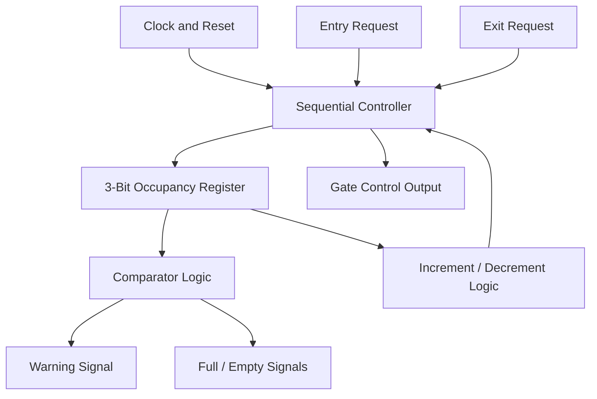
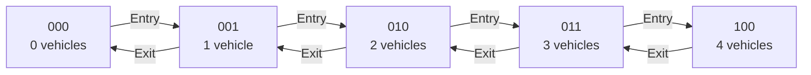
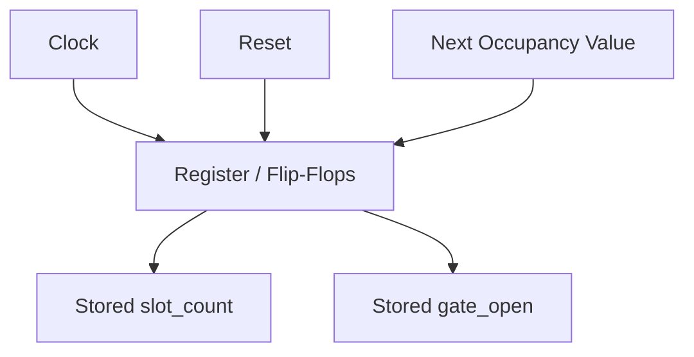
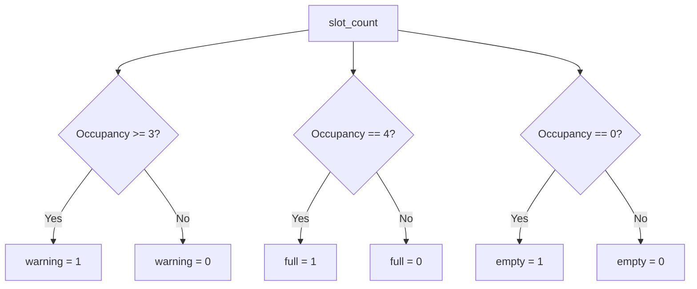
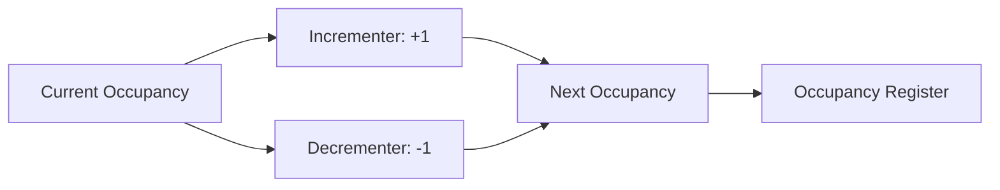
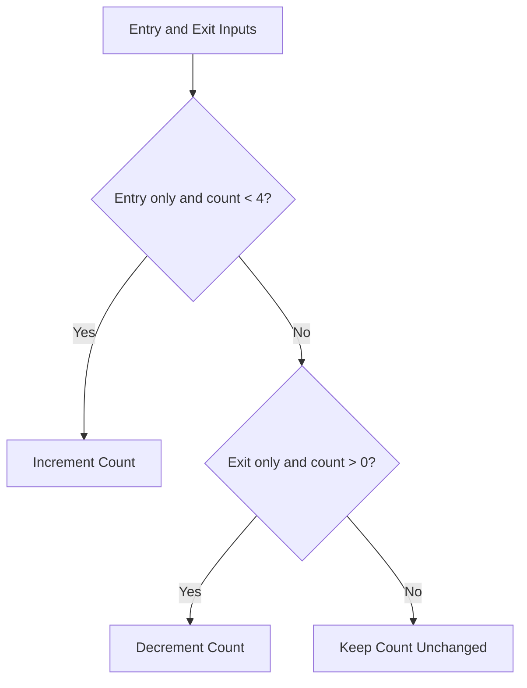
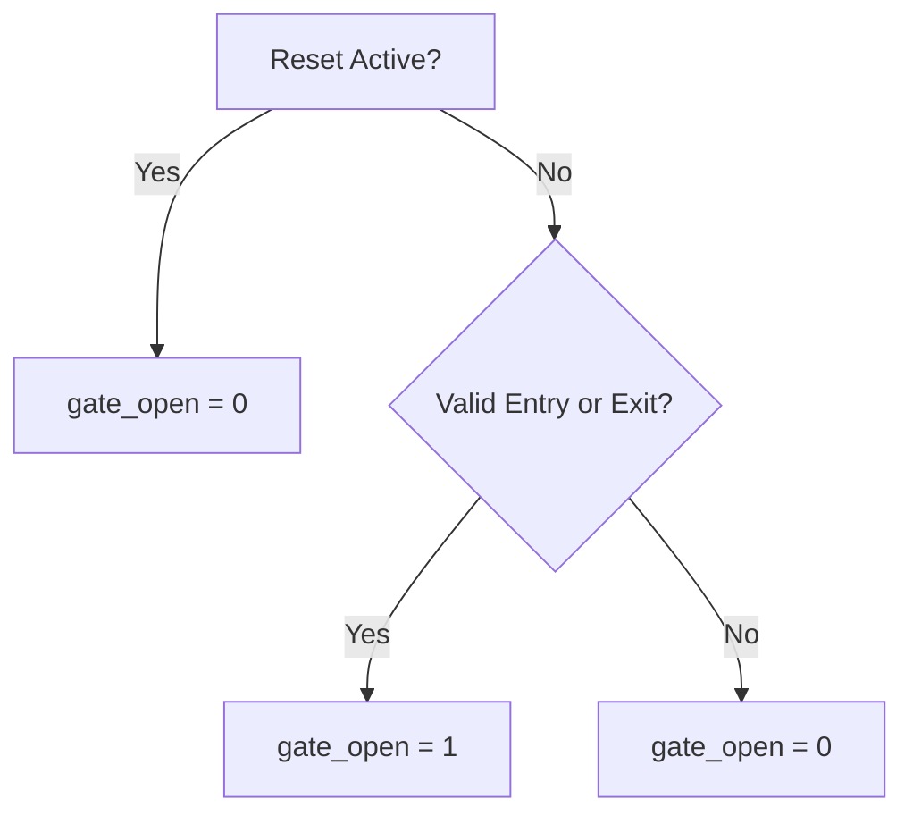

## 1. Introduction

The Four-Slot Smart Parking Occupancy and Gate Controller ASIC is a digital hardware design developed to manage vehicle parking occupancy in a small parking area with a maximum capacity of four vehicles. The project uses Verilog HDL to implement a controller that tracks occupied parking slots, processes vehicle entry and exit requests, and generates parking status and gate-control signals.

The design demonstrates how a real-world parking management function can be implemented at the Register Transfer Level (RTL) and taken through an Application-Specific Integrated Circuit (ASIC) design flow. The design is simulated and synthesized, followed by physical-design implementation and timing analysis using the SKY130 standard-cell platform and open-source VLSI tools.

This project provides practical experience in digital logic design, RTL coding, functional verification, logic synthesis, physical design, and static timing analysis.

## 2. Project Description

The proposed system is designed to manage a parking area containing four parking slots. It maintains a digital count of occupied slots and updates this count based on vehicle entry and exit requests.

When a valid vehicle entry request is received, the controller updates the occupancy count if parking capacity is available. When a valid exit request is received, the count decreases if at least one vehicle is parked. The controller also generates status signals to indicate whether the parking area is full or empty and provides a gate-control output according to the implemented control logic.

The design is written in Verilog HDL and verified using a testbench that applies different input sequences, including reset, entry, and exit operations. After functional verification, the RTL can be synthesized into a standard-cell netlist and processed through the ASIC physical-design flow.

The project uses the SKY130 HD standard-cell library and tools such as Icarus Verilog, GTKWave, Yosys, OpenLane, OpenROAD, and OpenSTA for simulation, waveform inspection, synthesis, physical design, and timing analysis.

### 2.1 Main Features

- Four-slot parking occupancy tracking.
- Vehicle entry and exit request processing.
- Full and empty parking status generation.
- Gate-control signal generation.
- Verilog RTL implementation and testbench verification.
- ASIC synthesis and physical-design implementation.
- Static timing analysis across selected process, voltage, and temperature (PVT) corners.

### 2.2 Project Scope

This project implements the **digital parking controller**, not a complete physical parking installation. Real vehicle sensors, a gate motor, and an external display or monitoring system would require additional hardware and interface integration.

## 3. Real-World Applications

### 3.1 Small Residential Parking Areas

The controller can be adapted for small apartment parking areas with a limited number of parking spaces. It tracks occupied slots and indicates when the configured parking capacity is reached.

### 3.2 Office and Campus Parking

Small offices, laboratories, and campus parking areas can use similar occupancy-control logic to monitor the number of vehicles inside a designated parking zone.

### 3.3 Parking Gate Automation

The `gate_open` output can act as a digital command signal for an external gate-control interface. A suitable motor driver, safety sensors, and gate mechanism would be required for physical gate operation.

### 3.4 Parking Occupancy Indicators

The `full`, `empty`, and `warning` outputs can be connected to external indicator circuits or a monitoring controller to display parking availability.

### 3.5 Embedded Systems and IoT Integration

The controller can be integrated with a microcontroller or communication interface to share occupancy information with a monitoring system. Communication and networking functionality are not implemented in the current RTL.

### 3.6 ASIC and VLSI Design Education

The project demonstrates practical digital-design concepts, including counters, registers, comparators, combinational control logic, and sequential circuits. It also provides experience with simulation, synthesis, physical design, and static timing analysis.

### 3.7 Scalable Parking Management Systems

The four-slot controller can serve as a reference architecture for designing larger-capacity systems. Increasing the capacity would require appropriate counter sizing, updated status comparisons, and additional verification.

##  Benefits

- Tracks parking occupancy digitally.
- Prevents the occupancy count from exceeding the configured capacity.
- Generates full, empty, and early-warning status signals.
- Provides a gate-control output for external hardware integration.
- Demonstrates an end-to-end ASIC design workflow.
- Offers a foundation for future expansion and system integration.

##  4.Digital Logical Circuits Used


The **Four-Slot Smart Parking Occupancy and Gate Controller ASIC** uses sequential and combinational digital logic to track parking occupancy, process vehicle entry and exit requests, and generate parking status and gate-control signals.

## 1. Overall Digital Controller Architecture

The following diagram illustrates the main inputs, controller logic, and outputs.



## 2. 3-Bit Occupancy Counter

The `slot_count` register stores the number of occupied slots from zero to four.

```verilog
output reg [2:0] slot_count;
```

### Binary Representation

| Occupied Slots | Binary Value |
|---:|:---:|
| 0 | `000` |
| 1 | `001` |
| 2 | `010` |
| 3 | `011` |
| 4 | `100` |



The counter increases on a valid entry and decreases on a valid exit. Entry is blocked when occupancy is four, and exit is blocked when occupancy is zero.

## 3. Registers and Flip-Flops

The controller uses clocked sequential logic to store the occupancy count and gate-control output.

```verilog
always @(posedge clk or posedge reset)
```



- `posedge clk` updates registers at the rising clock edge.
- `posedge reset` resets the stored values asynchronously.
- The occupancy count and gate output are reset to zero.

## 4. Comparator Logic

The controller compares the occupancy count with specific values to generate status outputs.

```verilog
assign warning = (slot_count >= 3);
assign full    = (slot_count == 4);
assign empty   = (slot_count == 0);
```



| Condition | Output |
|---|---|
| Occupancy is 3 or more | `warning = 1` |
| Occupancy equals 4 | `full = 1` |
| Occupancy equals 0 | `empty = 1` |

## 5. Incrementer and Decrementer

The arithmetic logic updates the occupancy counter.

```verilog
slot_count <= slot_count + 1;
slot_count <= slot_count - 1;
```



- **Incrementer:** increases the count for a valid entry.
- **Decrementer:** decreases the count for a valid exit.

## 6. Combinational Control Logic

The following conditions determine whether an entry or exit request is accepted.

```verilog
if (entry && !exit && (slot_count < 4))
```

```verilog
else if (exit && !entry && (slot_count > 0))
```



Simultaneous entry and exit requests do not update the occupancy count in this implementation.

## 7. Gate-Control Logic

The `gate_open` output is set high for an accepted entry or exit request and cleared during normal operation otherwise.



This output is a digital control signal. A physical gate motor would require additional driver and interface hardware.

 Instead, it uses a counter-based sequential controller with conditional control logic.

## 9. Digital Logic Summary

| Circuit / Concept | Purpose |
|---|---|
| 3-bit counter/register | Tracks occupied parking slots |
| Flip-flops | Store clocked values |
| Asynchronous reset | Initializes the controller |
| Comparators | Generate full, empty, and warning signals |
| Incrementer / decrementer | Update occupancy |
| Boolean control logic | Validate entry and exit requests |
| Gate-control register | Generates the gate command |

## 10. ASIC Implementation

The RTL is synthesized using Yosys and mapped to the SKY130 HD standard-cell library. The ASIC flow then uses OpenLane and OpenROAD for physical-design stages, with OpenSTA used for static timing analysis.

## 5.Tools, Languages and Linux Commands Used:

 ## 1. Programming Languages

| Language | Purpose |
|---|---|
| **Verilog HDL** | RTL design of the parking controller |
| **Verilog Testbench** | Functional verification of the RTL |
| **Tcl** | Automation and configuration of synthesis, physical design, and timing analysis |
| **Linux Shell / Bash** | Executing commands and managing project files |

## 2. Tools Used in the Project

| Tool | Purpose |
|---|---|
| **Icarus Verilog** | RTL and testbench simulation |
| **GTKWave** | Viewing simulation waveforms |
| **Yosys** | RTL synthesis and logic optimization |
| **OpenLane** | ASIC implementation flow |
| **OpenROAD** | Floorplanning, placement, clock-tree synthesis, and routing |
| **OpenSTA** | Static timing analysis |
| **Magic** | Layout inspection and physical-design visualization |
| **SKY130 HD PDK** | Standard-cell library and technology files |

## 3. Linux Commands Used

The following commands help navigate directories, inspect RTL files, run simulations, execute synthesis tools, and organize project reports.

## 3.1 Directory Navigation


### Commands

```bash
pwd
ls
ls -lh
cd ~/Desktop/four_slot_smart_parking
```

### Command Explanation

| Command | Purpose |
|---|---|
| `pwd` | Displays the current working directory |
| `ls` | Lists files and directories |
| `ls -lh` | Displays file and directory sizes in a human-readable format |
| `cd ~/Desktop/four_slot_smart_parking` | Changes the working directory to the parking project folder |

## 3.2 Inspecting Project Files

### Commands

```bash
find . -maxdepth 3 -type f
cat rtl/parking_controller.v
cat constraints/parking_controller.sdc
```

### Command Explanation

| Command | Purpose |
|---|---|
| `find` | Locates project files within the specified directory depth |
| `cat` | Displays the contents of RTL source and timing-constraint files |
| `parking_controller.sdc` | Contains timing constraints for the design, such as clock and input/output delays |

## 3.3 Creating and Organizing Directories

### Commands

```bash
mkdir -p reports
mkdir -p synthesis
mkdir -p physical_design/images
mkdir -p sta
```

### Command Explanation

| Command | Purpose |
|---|---|
| `mkdir -p reports` | Creates a directory for reports |
| `mkdir -p synthesis` | Creates a directory for synthesis outputs |
| `mkdir -p physical_design/images` | Creates directories for physical-design documentation and images |
| `mkdir -p sta` | Creates a directory for static timing analysis files |

The `-p` option creates parent directories when necessary and does not report an error if the directory already exists.

## 3.4 RTL Simulation Using Icarus Verilog

### Compile the RTL and Testbench

Run these commands from the project root directory:

```bash
iverilog -g2012 -o simulation.vvp \
  rtl/parking_controller.v \
  tb/tb_parking_controller.v
```

### Run the Simulation

```bash
vvp simulation.vvp
```

### View the Waveform

```bash
gtkwave parking_rtl.vcd
```

**Note:** The waveform filename must match the filename specified in the testbench's `$dumpfile` statement. In the current testbench, the filename is `parking_rtl.vcd`.

### Command Explanation

| Command | Purpose |
|---|---|
| `iverilog` | Compiles the Verilog RTL and testbench |
| `-g2012` | Enables SystemVerilog 2012 language support |
| `-o simulation.vvp` | Specifies the compiled simulation output file |
| `vvp` | Executes the compiled simulation |
| `gtkwave` | Opens the VCD waveform for signal inspection |

## 3.5 RTL Synthesis Using Yosys

### Start Yosys

```bash
yosys
```

### Commands Inside the Yosys Prompt

```tcl
read_verilog rtl/parking_controller.v
hierarchy -check -top parking_controller
proc
opt
check
stat
```

### Command Explanation

| Command | Purpose |
|---|---|
| `read_verilog` | Reads the RTL source file |
| `hierarchy -check -top parking_controller` | Checks the design hierarchy and identifies the top module |
| `proc` | Converts procedural RTL into internal logic |
| `opt` | Performs logic optimization |
| `check` | Checks for structural problems in the synthesized design |
| `stat` | Displays synthesis statistics, including cell counts |

This sequence performs basic RTL synthesis and logic inspection. Technology mapping to SKY130 requires the appropriate technology library and synthesis configuration.

### Exit Yosys

```tcl
exit
```

## 3.6 OpenLane Physical Design

### Technology and Tools

| Parameter | Description |
|---|---|
| RTL Language | Verilog HDL |
| Technology | SKY130 HD |
| Physical Design Flow | OpenLane v0.21 |
| Physical Design Engine | OpenROAD |

### Navigate to the OpenLane Installation

```bash
cd ~/Desktop/work/tools/openlane_working_dir/openlane
```

### Inspect Available Designs

```bash
ls designs
```

### Run the Smart Parking Design

```bash
./flow.tcl -design smart_parking
```

**Note:** The design name must match the actual OpenLane design configuration directory. The earlier OpenLane project used `smart_parking`; `four_slot_smart_parking` is the separate project workspace.

OpenLane automates multiple ASIC implementation stages, including synthesis, floorplanning, placement, clock-tree synthesis, routing, and physical-design checks, depending on the configuration.

## 3.7 OpenLane Interactive Mode

### Start Interactive Mode

From the OpenLane installation directory, run:

```bash
./flow.tcl -interactive
```

### Commands Inside the OpenLane Tcl Shell

```tcl
package require openlane
prep -design smart_parking
```

Use the appropriate configuration and existing run tag when inspecting or resuming a previous run.

## 3.8 Physical Design Stages and Commands

The following commands are intended for the OpenLane interactive Tcl shell, not the normal Linux terminal. Availability depends on the installed flow version and configuration.

### Synthesis

```tcl
run_synthesis
```

**Purpose:** Converts RTL into a synthesized gate-level netlist and maps the logic to the target standard-cell library.

### Floorplanning and Power Planning

```tcl
run_floorplan
```

**Purpose:** Establishes the floorplan, placement rows, pin locations, and power-distribution setup according to the design configuration.

### Placement

```tcl
run_placement
```

**Purpose:** Places standard cells within the floorplan and performs placement-related optimization.

### Clock Tree Synthesis (CTS)

```tcl
run_cts
```

**Purpose:** Builds the clock distribution network for sequential cells.

### Routing

```tcl
run_routing
```

**Purpose:** Connects the placed standard cells through routing layers while observing design rules and routing constraints.

### Physical Verification and Layout Operations

```tcl
run_magic
run_magic_drc
run_lvs
run_antenna_check
```

| Command | Purpose |
|---|---|
| `run_magic` | Performs Magic-related layout operations in the configured flow |
| `run_magic_drc` | Runs design-rule checking using Magic |
| `run_lvs` | Checks layout-versus-schematic consistency |
| `run_antenna_check` | Checks for antenna-rule violations |

The availability and exact behavior of these commands depend on the OpenLane version and design configuration.

## 3.9 Physical Design Flow Summary

| Stage | Command | Purpose |
|---|---|---|
| Synthesis | `run_synthesis` | Generates the mapped netlist |
| Floorplanning | `run_floorplan` | Defines the physical floorplan |
| Placement | `run_placement` | Places standard cells |
| Clock Tree Synthesis | `run_cts` | Builds the clock network |
| Routing | `run_routing` | Routes signal connections |
| Design Rule Checking | `run_magic_drc` | Checks layout design rules |
| Layout Versus Schematic | `run_lvs` | Compares layout and schematic connectivity |

**Documentation note:** These commands describe the flow and how the stages are used. Include only actual reports, screenshots, and results from stages you have executed in the project.


# Static Timing Analysis (STA)

## 1. Introduction

Static Timing Analysis (STA) verifies whether the digital design satisfies its timing constraints without applying simulation input vectors. This project uses OpenSTA and the SKY130 HD standard-cell library to analyze setup timing, hold timing, slack, and timing violations.

## 2. Tools Used

- **OpenSTA** — static timing analysis.
- **SKY130 HD Liberty files** — standard-cell timing models.
- **Verilog netlist** — synthesized or physically implemented design.
- **SDC** — clock and input/output timing constraints.
- **SPEF** — extracted parasitic information for post-route timing analysis, when available.

## 3. Locate STA Reports

Navigate to the OpenLane directory:

```bash
cd ~/Desktop/work/tools/openlane_working_dir/openlane
```

Find timing reports:

```bash
find designs/smart_parking/runs -type f \
  \( -iname '*sta*' -o -iname '*slack*' -o -iname '*tns*' \)
```

Search for setup and hold timing results:

```bash
grep -R -n -E 'Startpoint:|Endpoint:|slack|wns|tns' \
  designs/smart_parking/runs/
```

## 4. Run OpenSTA

OpenSTA can be launched from the terminal using:

```bash
sta
```

Inside the OpenSTA prompt, load the timing library, mapped netlist, design constraints, and parasitics as applicable.

```tcl
read_liberty path/to/sky130_fd_sc_hd__tt_025C_1v80.lib
read_verilog path/to/parking_controller_sky130.v
link_design parking_controller
read_sdc path/to/parking_controller.sdc
```

For post-route analysis, load the matching parasitic file after linking the design:

```tcl
read_spef path/to/parking_controller.spef
```

The paths and file names must match the actual project outputs. Use the correct Liberty corner and matching parasitics for the analysis being performed.

## 5. Timing Reports

```tcl
report_checks
report_worst_slack
report_tns
```

These reports help inspect timing paths, worst slack, and total negative slack. Command availability can vary with the installed OpenSTA version.

## 6. Timing Concepts

| Metric | Meaning |
|---|---|
| Setup slack | Measures whether data arrives before the required setup time |
| Hold slack | Measures whether data remains stable long enough after the clock edge |
| WNS | Worst negative slack, conventionally the most negative setup slack |
| TNS | Total negative slack across violating setup paths |
| PVT corners | Different process, voltage, and temperature conditions |

Positive slack generally indicates that a checked path meets its timing requirement. Negative slack indicates a timing violation.

## 7. Multi-Corner Timing Analysis

The project can be analyzed at different PVT corners using the corresponding SKY130 HD Liberty files, such as:

- **TT:** Typical process, typical operating conditions.
- **SS:** Slow process corner.
- **FF:** Fast process corner.

The exact voltage and temperature depend on the selected Liberty file. Each corner must use a compatible library and appropriate timing configuration.


## -------------------------------------------------------------------------------------------- ##


## RTL Design — Four-Slot Smart Parking Occupancy and Gate Controller ASIC

## 1. Introduction

Register Transfer Level (RTL) design is an important stage in digital IC development. It describes the behavior of digital hardware using a Hardware Description Language (HDL), such as Verilog.

In this project, Verilog HDL is used to implement a Four-Slot Smart Parking Occupancy and Gate Controller. The design manages parking occupancy, processes vehicle entry and exit requests, and generates status and gate-control signals.

The RTL is designed to be synthesizable and suitable for functional verification, logic synthesis, and subsequent ASIC physical-design implementation using the SKY130 HD standard-cell platform.

## 2. Design Objective

The primary objective is to develop a compact digital controller that manages a parking area with a maximum capacity of four vehicles.

The controller is designed to:
- Maintain the number of occupied parking slots.
- Accept valid vehicle entry requests when space is available.
- Accept valid vehicle exit requests when at least one vehicle is parked.
- Generate an early-warning signal when three or more slots are occupied.
- Indicate when the parking area is full or empty.
- Generate a gate-control signal for valid entry and exit operations.

## 3. RTL Module Description

**Module name:** `parking_controller`

**Hardware description language:** Verilog HDL

The design uses a 3-bit occupancy register, clocked sequential logic, arithmetic operations, and combinational comparison logic.

### Input Signals

| Signal | Description |
|---|---|
| `clk` | Clock input for sequential operations |
| `reset` | Asynchronous active-high reset |
| `entry` | Vehicle entry request |
| `exit` | Vehicle exit request |

### Output Signals

| Signal | Description |
|---|---|
| `slot_count[2:0]` | Current number of occupied parking slots |
| `warning` | High when occupancy reaches three or more |
| `full` | High when all four slots are occupied |
| `empty` | High when no vehicles are parked |
| `gate_open` | Gate-control output |

## 4. RTL Architecture

The controller consists of the following functional blocks:

1. **Occupancy register:** Stores the number of occupied slots.
2. **Increment and decrement logic:** Updates occupancy after valid entry and exit requests.
3. **Comparator logic:** Generates warning, full, and empty status signals.
4. **Control logic:** Checks entry and exit conditions and controls the gate output.
5. **Reset logic:** Initializes the occupancy count and gate-control output.

## 5. Occupancy Counter Operation

The design uses a 3-bit register to represent parking occupancy.

| Occupancy | Binary value | Status |
|---:|:---:|---|
| 0 | `000` | Empty |
| 1 | `001` | Space available |
| 2 | `010` | Space available |
| 3 | `011` | Warning active |
| 4 | `100` | Full and warning active |

Three bits are sufficient to represent all required occupancy values from zero through four.

## 6. Entry and Exit Control

### Vehicle Entry

When `entry = 1`, `exit = 0`, and `slot_count < 4`, the controller increments the occupancy count and sets `gate_open` to `1`.

If all four slots are occupied, an additional entry request does not increase the count.

### Vehicle Exit

When `exit = 1`, `entry = 0`, and `slot_count > 0`, the controller decrements the occupancy count and sets `gate_open` to `1`.

If the parking area is already empty, an exit request does not decrease the count below zero.

### Simultaneous Requests

When both `entry` and `exit` are asserted, neither request is accepted by the current control logic, and the occupancy count remains unchanged.

## 7. Reset and Sequential Logic

The design uses the following clocked process:

```verilog
always @(posedge clk or posedge reset)
```

The asynchronous, active-high reset initializes:
- `slot_count = 0`
- `gate_open = 0`

During normal operation, the occupancy register and gate-control output are updated according to the clock and input conditions.

## 8. Functional Verification

The RTL is verified using a Verilog testbench.

The testbench applies clock and reset signals and exercises:
- Vehicle entry requests.
- Filling all four parking slots.
- An additional entry request when the parking area is full.
- A vehicle exit request.
- Repeated exit requests near the empty boundary.

Icarus Verilog is used to compile and simulate the design. GTKWave can be used to inspect the generated `parking_rtl.vcd` waveform.

## 9. Synthesis and ASIC Implementation

After functional verification, the RTL can be synthesized using Yosys and mapped to the SKY130 HD standard-cell library.

The design is then processed through the configured OpenLane/OpenROAD physical-design flow. OpenSTA is used to analyze timing using the relevant constraints, libraries, and parasitic data.

## RTL Design Code:

```verilog
module parking_controller (
    input  wire       clk,
    input  wire       reset,
    input  wire       entry,
    input  wire       exit,
    output reg  [2:0] slot_count,
    output wire       warning,
    output wire       full,
    output wire       empty,
    output reg        gate_open
);

    // Early warning when 3 or more slots are occupied
    assign warning = (slot_count >= 3);

    // Parking status indicators
    assign full  = (slot_count == 4);
    assign empty = (slot_count == 0);

    // Occupancy counter and gate-control logic
    always @(posedge clk or posedge reset) begin
        if (reset) begin
            slot_count <= 0;
            gate_open  <= 0;
        end else begin
            gate_open <= 0;

            // Accept vehicle entry if parking is not full
            if (entry && !exit && (slot_count < 4)) begin
                slot_count <= slot_count + 1;
                gate_open  <= 1;
            end

            // Accept vehicle exit if parking is not empty
            else if (exit && !entry && (slot_count > 0)) begin
                slot_count <= slot_count - 1;
                gate_open  <= 1;
            end
        end
    end

endmodule
```
## TestBench Code:

```verilog
`timescale 1ns/1ps

module tb_parking_controller;

    reg clk;
    reg reset;
    reg entry;
    reg exit;

    wire [2:0] slot_count;
    wire warning;
    wire full;
    wire empty;
    wire gate_open;

    // Instantiate the parking controller
    parking_controller dut (
        .clk(clk),
        .reset(reset),
        .entry(entry),
        .exit(exit),
        .slot_count(slot_count),
        .warning(warning),
        .full(full),
        .empty(empty),
        .gate_open(gate_open)
    );

    // Generate 10 ns clock period
    always #5 clk = ~clk;

    initial begin
        // Generate waveform file
        $dumpfile("parking_rtl.vcd");
        $dumpvars(0, tb_parking_controller);

        // Initialize signals
        clk = 0;
        reset = 1;
        entry = 0;
        exit = 0;

        // Apply reset
        #10;
        reset = 0;

        // Test vehicle entries: occupancy 0 to 4
        repeat (4) begin
            @(negedge clk);
            entry = 1;

            @(negedge clk);
            $display(
                "Count=%0d Warning=%b Full=%b Empty=%b Gate=%b",
                slot_count, warning, full, empty, gate_open
            );
            entry = 0;
        end

        // Test entry when parking is full
        @(negedge clk);
        entry = 1;

        @(negedge clk);
        $display(
            "After extra entry: Count=%0d Full=%b",
            slot_count, full
        );
        entry = 0;

        // Test vehicle exit
        @(negedge clk);
        exit = 1;

        @(negedge clk);
        $display(
            "After exit: Count=%0d Warning=%b Full=%b",
            slot_count, warning, full
        );
        exit = 0;

        // Test exit when parking is empty
        repeat (3) begin
            @(negedge clk);
            exit = 1;

            @(negedge clk);
            exit = 0;
        end

        $display(
            "Final Count=%0d Empty=%b",
            slot_count, empty
        );

        #10;
        $finish;
    end

endmodule
```

## Explanation for codes :

he Four-Slot Smart Parking Occupancy and Gate Controller is a digital hardware design implemented using Verilog HDL. It monitors parking occupancy, controls entry and exit requests, and generates status signals to indicate whether the parking area is empty, nearly full, or completely full.

The design supports a maximum of four vehicles. It uses sequential logic to update the occupancy count and combinational logic to generate parking status indicators.

he Four-Slot Smart Parking Occupancy and Gate Controller is a digital hardware design implemented using Verilog HDL. It monitors parking occupancy, controls entry and exit requests, and generates status signals to indicate whether the parking area is empty, nearly full, or completely full.

The design supports a maximum of four vehicles. It uses sequential logic to update the occupancy count and combinational logic to generate parking status indicators.

This project demonstrates the RTL design and functional verification stages of a basic ASIC design flow.


## 2. Design Objectives

- Track the number of occupied parking slots.
- Accept vehicle entry requests when parking space is available.
- Accept vehicle exit requests when at least one vehicle is parked.
- Prevent occupancy from exceeding four vehicles.
- Prevent occupancy from decreasing below zero.
- Generate an early warning when three or more slots are occupied.
- Generate full and empty status signals.
- Control the gate-open indication for accepted entry and exit requests.
- Verify functionality using a Verilog testbench and waveform simulation.

## 3. RTL Design Overview

- **Top Module:** `parking_controller`
- **Hardware Description Language:** Verilog HDL
- **Design Type:** Sequential and combinational digital logic

### 3.1 Input Signals

| Signal | Width | Description |
|---|---|---|
| `clk` | 1 bit | Clock signal for sequential operation |
| `reset` | 1 bit | Active-high asynchronous reset |
| `entry` | 1 bit | Vehicle entry request |
| `exit` | 1 bit | Vehicle exit request |

### 3.2 Output Signals

| Signal | Width | Description |
|---|---|---|
| `slot_count` | 3 bits | Number of occupied slots, from 0 to 4 |
| `warning` | 1 bit | High when three or more slots are occupied |
| `full` | 1 bit | High when all four slots are occupied |
| `empty` | 1 bit | High when no slots are occupied |
| `gate_open` | 1 bit | High for an accepted entry or exit operation |

## 4. RTL Design Architecture

The design consists of the following functional blocks.

### 4.1 Occupancy Counter

The `slot_count` register stores the current number of occupied parking slots.

- Increments by one for a valid entry request.
- Decrements by one for a valid exit request.
- Resets to zero when reset is asserted.
- Maintains a valid occupancy range of zero to four.

Although the register is three bits wide, the control logic restricts the occupancy count to the range required for four parking slots.

### 4.2 Entry Control Logic

When `entry = 1`, `exit = 0`, and `slot_count < 4`, the design increments the occupancy count and sets `gate_open` to high.

When the parking area is full, additional entry requests are rejected.

### 4.3 Exit Control Logic

When `exit = 1`, `entry = 0`, and `slot_count > 0`, the design decrements the occupancy count and sets `gate_open` to high.

When the parking area is empty, additional exit requests are rejected.

### 4.4 Parking Status Logic

The design generates three status indicators:

- **Warning:** Activated when three or four slots are occupied.
- **Full:** Activated when the occupancy count reaches four.
- **Empty:** Activated when the occupancy count is zero.

These signals are derived from the current occupancy count using combinational logic.

### 4.5 Gate Control Logic

The `gate_open` output is cleared by default on each active clock edge during normal operation. It becomes high when a valid entry or exit operation is accepted.

This output is a digital gate-control indication. Driving a real gate motor requires additional driver circuitry and suitable control hardware.

## 5. RTL Code Explanation

The main RTL file is `rtl/parking_controller.v`.

### 5.1 Module Declaration

The module declaration defines the inputs and outputs of the parking controller. The `slot_count` register is three bits wide, allowing it to represent values from zero to seven, while the design logic limits valid occupancy to zero through four.

### 5.2 Combinational Assignments

The `assign` statements continuously derive `warning`, `full`, and `empty` from `slot_count`.

This avoids the need for separate registers for these status outputs.

### 5.3 Sequential Logic

The `always @(posedge clk or posedge reset)` block describes the sequential behavior of the design.

The asynchronous active-high reset clears the occupancy counter and closes the gate indication immediately when reset is asserted. Otherwise, the counter and gate-control register update in response to the clock and input requests.

### 5.4  Nonblocking Assignments

The `<=` operator is used for register assignments. Nonblocking assignments are appropriate for modeling clocked sequential logic in Verilog.

## Testbench Overview

- **Testbench File:** `testbench/tb_parking_controller.v`
- **Testbench Module:** `tb_parking_controller`

The testbench verifies the parking controller by applying input sequences and observing the output signals. It instantiates the design under test and generates a clock, reset, entry requests, and exit requests.

The testbench does not represent physical parking hardware. It is a simulation environment used to verify the digital RTL.

## 6. Testbench Code Explanation

### 6.1 Timescale Directive

The directive `` `timescale 1ns/1ps `` specifies a simulation time unit of one nanosecond and a time precision of one picosecond.

### 6.2 Signal Declaration

The testbench declares `clk`, `reset`, `entry`, and `exit` as registers because the testbench drives these signals.

The outputs of the design are declared as wires because they are driven by the instantiated module.

### 6.3 Design Instantiation

The `parking_controller` module is instantiated as `dut`, meaning Design Under Test.

The instance connects the testbench signals to the corresponding RTL inputs and outputs.

### 6.4 Clock Generation

The statement `always #5 clk = ~clk;` toggles the clock every five nanoseconds, producing a clock period of ten nanoseconds.

### 6.5 Waveform Generation

The `$dumpfile` and `$dumpvars` system tasks generate a VCD waveform file named `parking_rtl.vcd`.

This file can be opened in GTKWave to inspect the clock, reset, entry, exit, occupancy count, warning, full, empty, and gate-open signals over simulation time.

### 6.6 Reset Test

The testbench initially asserts reset and initializes the input signals. After ten nanoseconds, reset is deasserted so that normal operation can begin.

### 6.7 Vehicle Entry Test

The testbench applies four entry requests to increase occupancy from zero to four. It displays the occupancy and status outputs for inspection.

### 6.8 Entry When Full

After the occupancy reaches four, the testbench applies another entry request. The expected behavior is that occupancy remains four and the full indicator remains high.

### 6.9 Vehicle Exit Test

The testbench applies an exit request. The expected behavior is that occupancy decreases from four to three, the full indicator becomes low, and the warning indicator remains high.

### 6.10 Exit When Empty

The testbench applies additional exit requests. The expected behavior is that the occupancy count never becomes negative and remains zero once the parking area is empty.

### 6.11 Simulation Completion

The `$display` statements print selected output values to the simulator console. The `$finish` statement terminates the simulation.

The testbench currently uses printed output rather than automatic assertions, so the results must be inspected to confirm the expected behavior.

## Functional Verification Plan

| Test Case | Expected Behavior |
|---|---|
| Reset | Occupancy becomes zero and gate closes |
| Valid entry | Occupancy increases by one |
| Entry until full | Occupancy reaches four |
| Entry while full | Occupancy remains four |
| Valid exit | Occupancy decreases by one |
| Exit while empty | Occupancy remains zero |
| Warning threshold | Warning is high at occupancy three or four |
| Full indication | Full is high only at occupancy four |
| Empty indication | Empty is high only at occupancy zero |
| Simultaneous entry and exit | Neither request is accepted; occupancy holds |


## RTL Simulation and Waveform Generation

###  Objective

RTL simulation verifies the functional behavior of the `parking_controller` design before synthesis and physical implementation. GTKWave is used to visualize the input and output signals during simulation.

### Commands to Run RTL Simulation

Navigate to the project directory:

```bash
cd ~/Desktop/four_slot_smart_parking
```

Compile the RTL design and testbench:

```bash
iverilog -g2012 -o rtl_sim.vvp \
  rtl/parking_controller.v \
  tb/tb_parking_controller.v
```

Run the simulation:

```bash
vvp rtl_sim.vvp
```

Open the generated waveform:

```bash
gtkwave parking_rtl.vcd
```

###  Waveform File Generation

The testbench generates the waveform file using the following Verilog system tasks:

```verilog
$dumpfile("parking_rtl.vcd");
$dumpvars(0, tb_parking_controller);
```

The `parking_rtl.vcd` file stores the signal transitions recorded during simulation.

### Signals Observed in GTKWave

| Signal | Description |
|---|---|
| `clk` | Clock signal |
| `reset` | Resets the controller |
| `entry` | Indicates a vehicle entry request |
| `exit` | Indicates a vehicle exit request |
| `slot_count` | Tracks the number of occupied slots |
| `warning` | Becomes high when three or more slots are occupied |
| `full` | Becomes high when all four slots are occupied |
| `empty` | Becomes high when no slots are occupied |
| `gate_open` | Indicates an accepted entry or exit operation |

### Simulation Behavior

- Reset initializes the slot count to zero and closes the gate.
- Accepted entry requests increment the slot count.
- Accepted exit requests decrement the slot count.
- The slot count remains between zero and four.
- The warning signal becomes high when the count reaches three.
- The full signal becomes high at four occupied slots.
- The empty signal becomes high when the count is zero.
- Invalid entry and exit requests do not change the slot count.

###  Verification Result

After running the simulation, inspect the console output and GTKWave waveform to verify the controller's behavior. Record the final verification result only after confirming that the observed signals match the expected behavior.

##  Waveform:


## RTL Synthesis Using Yosys

### Introduction

RTL synthesis is the process of converting a Verilog RTL description into a gate-level representation of a digital circuit. In this project, Yosys is used to analyze and synthesize the `parking_controller` module.

The synthesis process identifies sequential elements, combinational logic, arithmetic operations, and control conditions described in the RTL. It also provides statistics about the resulting logic structure.

###  Synthesis Objectives

- Read and analyze the Verilog RTL source.
- Check the design hierarchy and top module.
- Convert procedural blocks into internal logic.
- Optimize the synthesized logic.
- Check for structural problems.
- Generate synthesis statistics.

###  RTL Source File

The RTL source file is:

```text
rtl/parking_controller.v
```

The top module is `parking_controller`.

###  Running Yosys

From the project root directory, start Yosys:

```bash
yosys
```

Execute the following commands inside the Yosys prompt:

```tcl
read_verilog rtl/parking_controller.v
hierarchy -check -top parking_controller
proc
opt
check
stat
```

### Synthesis Command Explanation

| Command | Purpose |
|---|---|
| `read_verilog` | Reads the Verilog RTL source file |
| `hierarchy -check -top parking_controller` | Checks the module hierarchy and identifies the top module |
| `proc` | Converts procedural RTL blocks into internal logic |
| `opt` | Performs logic optimization |
| `check` | Checks for structural problems in the design |
| `stat` | Displays statistics about the synthesized logic |

### Synthesis Flow

The basic synthesis sequence follows these steps:

1. Read the RTL source code.
2. Check the design hierarchy.
3. Convert procedural blocks into internal logic.
4. Optimize the logic representation.
5. Check the design for structural issues.
6. Display synthesis statistics.

### Synthesis Structure

The parking controller RTL describes the following types of logic:

- **Sequential logic:** Registers for `slot_count` and `gate_open`.
- **Combinational logic:** Status comparisons for `warning`, `full`, and `empty`.
- **Arithmetic logic:** Increment and decrement operations on `slot_count`.
- **Control logic:** Conditions that accept or reject entry and exit requests.

The actual cell count and mapped gate structure depend on the synthesis commands, optimization settings, and target technology library.

### Technology Mapping

The commands above perform basic RTL synthesis and logic inspection. They do not, by themselves, perform complete SKY130 standard-cell technology mapping.

For ASIC implementation, the logic must be mapped to cells from the target standard-cell library using an appropriate synthesis configuration. In this project, the SKY130 HD library is used in the configured OpenLane flow.

### Synthesis Results and Reports

After running the commands, review the output from `check` and `stat`.

| Result | What to inspect |
|---|---|
| Hierarchy | Confirm that `parking_controller` is recognized as the top module |
| Structural check | Review any reported problems |
| Logic statistics | Record the cell types and counts reported by Yosys |
| Technology mapping | Confirm the target library and mapped netlist when using the ASIC flow |

Record the actual results from your terminal rather than inserting assumed cell counts.

### Conclusion

Yosys provides an important step between RTL development and physical design. It helps inspect the logic inferred from Verilog and provides statistics that can be used to understand the hardware implementation.

The synthesized design can then proceed through the configured ASIC implementation flow for technology mapping, floorplanning, placement, clock-tree synthesis, routing, and timing analysis.

## Synthesized model:


## Statistics:


##  Gate-Level Simulation (GLS)

### Introduction

Gate-Level Simulation (GLS) is the process of simulating a synthesized gate-level netlist to verify the behavior of the synthesized design.

In this project, GLS is used to check whether the synthesized `parking_controller` design behaves consistently with the original RTL design under the same testbench stimulus.

Unlike RTL simulation, which operates on behavioral Verilog descriptions, gate-level simulation operates on the synthesized netlist containing logic cells or gate-level representations.

### Objectives

- Verify the functionality of the synthesized netlist.
- Check the behavior of occupancy counting and gate-control logic.
- Verify full, empty, and warning status signals.
- Check entry and exit boundary conditions.
- Identify potential differences between RTL and synthesized netlist behavior.

### Files Required

The gate-level simulation requires the following files:

| File | Purpose |
|---|---|
| `parking_controller.v` | Original RTL design, used for reference |
| `tb_parking_controller.v` | Testbench providing clock, reset, entry, and exit inputs |
| `synth_netlist.v` | Synthesized gate-level netlist generated by the synthesis flow |
| SKY130 standard-cell library models, when required | Provide functional models for mapped standard cells |

The actual netlist filename depends on the synthesis flow and output configuration.

### Gate-Level Simulation Flow

The GLS process follows these steps:

1. Synthesize the RTL design.
2. Obtain the synthesized gate-level netlist.
3. Prepare the testbench and required cell models.
4. Compile the netlist and testbench.
5. Run the simulation.
6. Inspect the output signals and waveform.
7. Compare the observed behavior against the RTL simulation.

### Simulation Commands

If the synthesized netlist is a self-contained Verilog file named `synth_netlist.v`, the following commands illustrate the basic flow:

```bash
iverilog -g2012 -s tb_parking_controller \
  -o gls.vvp \
  synth_netlist.v \
  tb/tb_parking_controller.v
```

Run the compiled simulation:

```bash
vvp gls.vvp
```

Open the waveform if the testbench generates `parking_rtl.vcd`:

```bash
gtkwave parking_rtl.vcd
```


### Functional Checks

| Test Case | Expected Behavior |
|---|---|
| Reset | Occupancy becomes zero and gate closes |
| Valid entry | Occupancy increases by one |
| Entry when full | Occupancy remains four |
| Valid exit | Occupancy decreases by one |
| Exit when empty | Occupancy remains zero |
| Warning status | High at occupancy three or four |
| Full status | High at occupancy four |
| Empty status | High at occupancy zero |

The actual results must be confirmed by running the simulation and inspecting the output or waveform.

### Timing-Aware Gate-Level Simulation

A gate-level netlist can be simulated with or without timing information.

- **Functional GLS:** Checks logical behavior without detailed cell timing delays.
- **Timing-aware GLS:** Uses appropriate timing-annotated netlists and delay information, commonly through SDF annotation, to examine timing-related behavior.

Timing-aware GLS requires the correct netlist, cell timing models, SDF file, and simulator setup. It is distinct from Static Timing Analysis (STA), which checks timing constraints analytically.

### Conclusion

Gate-Level Simulation provides an additional verification step after RTL synthesis. It helps confirm that the synthesized hardware representation preserves the intended parking-controller functionality.

## GLS Simulation Waveform:


## RTL and Gate-Level Simulation Waveform Comparison

### Introduction

RTL simulation and Gate-Level Simulation (GLS) are used to verify the functionality of the parking controller at different stages of the ASIC design flow.

RTL simulation verifies the original Verilog design, while GLS verifies the synthesized gate-level netlist. Both simulations should demonstrate equivalent logical behavior when the same input sequences are applied.

### RTL Simulation vs. Gate-Level Simulation

| Parameter | RTL Simulation | Gate-Level Simulation (GLS) |
|---|---|---|
| Design representation | Behavioral Verilog RTL | Synthesized gate-level netlist |
| Purpose | Verify the intended design functionality | Verify the functionality of the synthesized design |
| Simulation inputs | Clock, reset, entry, and exit | Same testbench input sequences |
| Occupancy counter | Updates according to the RTL logic | Expected to follow the same logical behavior |
| Warning, full, and empty signals | Generated from the occupancy count | Expected to match the RTL behavior |
| Gate-open signal | Indicates accepted entry or exit requests | Expected to follow the same logical behavior |
| Timing behavior | Generally uses RTL simulation semantics | May include cell delays, depending on the simulation setup |

### Waveform Behavior

The following behaviors should be consistent between RTL simulation and GLS:

- Reset initializes the occupancy count to zero and closes the gate.
- Valid vehicle entries increase the occupancy count up to four.
- Additional entry requests are rejected when the parking area is full.
- Valid vehicle exits decrease the occupancy count.
- Additional exit requests are rejected when the parking area is empty.
- The warning signal is high when three or four slots are occupied.
- The full signal is high when all four slots are occupied.
- The empty signal is high when no slots are occupied.
- The gate-open signal becomes high when an entry or exit request is accepted.

### Timing Differences

In functional GLS without modeled cell delays, RTL and GLS should exhibit equivalent logical behavior.

In timing-aware GLS, transitions may occur at different times because of standard-cell propagation delays and other modeled timing effects. Therefore, the waveforms may not be visually identical even when the logical behavior is correct.

###  Waveform Comparison

To compare the waveforms:

1. Apply the same testbench stimulus to the RTL and synthesized netlist.
2. Open the respective waveform files in GTKWave.
3. Compare the occupancy count and status signals.
4. Check whether entry and exit boundary conditions behave as expected.
5. Investigate any unexpected logical differences.

## Waveforms


### Conclusion

RTL simulation and Gate-Level Simulation provide complementary verification stages in the ASIC design flow. RTL simulation verifies the intended functionality, while GLS checks whether the synthesized netlist preserves that functionality.

## Observation

Pre level simulation and post level simulation waverforms are matched.


## Technology Mapping Using Yosys


### What Is Technology Mapping

Technology mapping is the process of converting a generic synthesized logic network into cells available in a specific standard-cell library.

In this project, Yosys is used to synthesize the `parking_controller` RTL, and the SKY130 HD standard-cell library provides the target cells for ASIC implementation.

Examples of standard cells include:
- AND, OR, and NOT gates
- Multiplexers
- Flip-flops
- Buffers

### Technology Mapping Flow

The technology-mapping process follows these steps:

1. Read the Verilog RTL file.
2. Check the design hierarchy.
3. Convert procedural logic into an internal representation.
4. Optimize the synthesized logic.
5. Map the logic to cells in the SKY130 HD library.
6. Generate the mapped gate-level netlist.
7. Inspect the mapped netlist and cell statistics.

### Yosys Commands

The following commands illustrate technology mapping using the SKY130 HD standard-cell library.

```bash
yosys
```

Inside the Yosys prompt:

```tcl
read_verilog rtl/parking_controller.v
hierarchy -check -top parking_controller
synth -top parking_controller
dfflibmap -liberty /path/to/sky130_fd_sc_hd__tt_025C_1v80.lib
abc -liberty /path/to/sky130_fd_sc_hd__tt_025C_1v80.lib
clean
stat -liberty /path/to/sky130_fd_sc_hd__tt_025C_1v80.lib
write_verilog -noattr reports/parking_controller_mapped.v
```


### Mapping Results

After technology mapping, inspect the Yosys statistics and generated netlist to identify the standard cells used to implement the controller.

Record the following results after running the commands:

| Parameter | Result |
|---|---|
| Target library | SKY130 HD |
| Top module | `parking_controller` |
| Mapped standard-cell count | To be verified |
| Flip-flop count | To be verified |
| Combinational cell count | To be verified |
| Mapped netlist | `reports/parking_controller_mapped.v` |

### Technology Mapping vs. Physical Design

Technology mapping produces a standard-cell netlist. Physical design then places these cells, builds the clock tree, routes the connections, and performs physical verification and timing analysis.

The OpenLane flow can perform technology mapping as part of its synthesis stage. The standalone Yosys commands above are provided to help inspect the mapping process independently.


# Figures:


## ---------------------------------------------------------------------------------------------##


## Physical Design from Netlist to GDSII

Physical design is process of transforming netlist into layout which is manufacture-able [GDS]. Physical design process is often referred as PnR (Place and Route). Main steps in physical design are placement of all logical cells, clock tree synthesis & routing. During this process of physical design timing, power, design & technology constraints have to be met. Further design might require being optimized w.r.t power, performance and area.

Physical design converts the synthesized gate-level netlist into a physical layout suitable for ASIC implementation. OpenLane automates several stages of the RTL-to-GDSII flow using tools such as OpenROAD, Magic, and other supporting utilities.

###  Physical Design Flow

The main stages of the physical design flow are:

1. **Floorplanning:** Defines the core and die area and prepares the design for physical implementation.
2. **Placement:** Places standard cells within the floorplan.
3. **Clock Tree Synthesis (CTS):** Builds a clock distribution network for sequential elements.
4. **Routing:** Creates electrical connections between placed cells.
5. **Design Rule Check (DRC):** Checks whether the layout follows the applicable physical design rules.
6. **GDSII Generation:** Produces the layout database used for ASIC fabrication handoff.


#### Synthesis
Generating gate-level netlist (yosys).
Performing cell mapping (abc).
Performing pre-layout STA (OpenSTA).
#### Floorplanning
Defining the core area for the macro as well as the cell sites and the tracks .
Placing the macro input and output ports (ioplacer).
Generating the power distribution network (pdn).
#### Placement
Performing global placement .
Perfroming detailed placement to legalize the globally placed components .
#### Clock Tree Synthesis (CTS)
Synthesizing the clock tree (TritonCTS).
#### Routing
Performing global routing to generate a guide file for the detailed router (FastRoute).
Performing detailed routing (TritonRoute)
#### GDSII Generation
Streaming out the final GDSII layout file from the routed def (Magic).


###  OpenLane Command

The OpenLane flow can be started using:

```bash
cd ~/Desktop/work/tools/openlane_working_dir/openlane
./flow.tcl -design smart_parking
```

The design name must match the configured OpenLane design directory.

### Physical Design Reports

The generated reports can be used to evaluate:

- Standard-cell placement and utilization
- Clock tree and routing results
- Timing performance
- Design rule violations
- Final layout generation status


## Build OpenRoad/ Openlane container

OpenLane Interactive Mode Commands

OpenLane interactive mode allows individual stages of the ASIC implementation flow to be executed and inspected separately.


1. Start OpenLane Interactive Mode
```
cd ~/Desktop/work/tools/openlane_working_dir/openlane
./flow.tcl -interactive
```
2. Load OpenLane and Prepare the Design

```
package require openlane 0.9
prep -design smart_parking
```

3. Run Individual Flow Stages
```
run_synthesis
run_floorplan
run_placement
run_cts
run_routing
```

4. Run Physical Verification
```
run_magic
run_magic_drc
run_lvs
run_antenna_check
```
5. Exit Interactive Mode

exit


## Synthesis

Synthesis converts the Verilog RTL description of the Four-Slot Smart Parking Controller into a gate-level logic representation for ASIC implementation.

**Tools Used:**
- **Yosys:** Performs RTL synthesis and logic optimization.
- **ABC:** Optimizes combinational logic and maps it to standard cells.
- **OpenSTA:** Performs pre-layout static timing analysis using the synthesized netlist, timing constraints, and cell-library information.

**Synthesis Operations:**

1. Read and elaborate the RTL design.
2. Check the design hierarchy.
3. Convert procedural logic into an internal representation.
4. Optimize the logic.
5. Map the logic to cells from the SKY130 HD standard-cell library.
6. Generate the synthesized netlist and reports.

**OpenLane Interactive Commands:**

```tcl
run_synthesis
```

** Outputs:**
- Synthesized gate-level netlist
- Standard-cell mapping statistics
- Synthesis reports
- Pre-layout timing reports, when generated by the configured flow.
- 
## Figures:

### ABC Results


### Pre-Synthesized Netlist:


### Synthesized Netlist:


Calcuation of Flop Ratio:
```
Flop ratio = Number of D Flip flops 
           ______________________
           Total Number of cells
```
To Invoke synthesis type run_synthesis.This runs the synthesis where yosys translates RTL into circuit using generic components and abc maps the circuit to Standard Cells.


## Floorplan


### Overview

Floorplanning is an important stage in the ASIC physical design flow. It defines the chip's die boundary and the core region where standard cells and other physical structures are placed.

For the Four-Slot Smart Parking Occupancy and Gate Controller, floorplanning was performed using the OpenLane flow with the SKY130 HD standard-cell library.

### Objectives

The main objectives of floorplanning are:

- Define the die and core dimensions.
- Establish the region available for standard-cell placement.
- Prepare the design for power distribution and subsequent physical-design stages.
- Provide the initial physical layout for placement, clock-tree synthesis, and routing.

### Floorplanning Results

The following dimensions were obtained from the OpenLane run `21-10_11-34`.

| Parameter | Value |
|---|---:|
| Design top module | `parking_controller` |
| Standard-cell library | SKY130 HD |
| Die width | 39.705 µm |
| Die height | 50.425 µm |
| Calculated die area | 2,002.13 µm² |
| Core width | 28.52 µm |
| Core height | 27.20 µm |
| Calculated core area | 775.744 µm² |

### Area Calculations

The die area is calculated by multiplying the die width by the die height.

Die area:

`39.705 µm × 50.425 µm = 2,002.13 µm²`

The core area is calculated by multiplying the core width by the core height.

Core area:

`28.52 µm × 27.20 µm = 775.744 µm²`

### Die Area vs. Core Area

- **Die area:** The total area enclosed by the chip's die boundary.
- **Core area:** The region inside the die allocated for the core design and associated physical structures.

The core is smaller than the die because the die boundary also includes the surrounding region outside the core.

### Verification

The dimensions were verified using the OpenLane floorplan log and the final routed DEF file.

Files used for verification:

- `logs/floorplan/3-verilog2def.openroad.log`
- `results/routing/parking_controller.def`
- 


### Outcome

Floorplanning established the die and core dimensions for the smart parking controller ASIC. These boundaries provide the physical-design framework for the subsequent placement, clock-tree synthesis, and routing stages.

### command

```
run_floorplan
```


Floorplan:

Defines the chip/core area, rows, pins and power-planning preparation.


```
openroad
read_lef $::env(PDK_ROOT)/sky130A/libs.ref/sky130_fd_sc_hd/techlef/sky130_fd_sc_hd__nom.tlef
read_def ~/Desktop/work/tools/openlane_working_dir/openlane/designs/smart_parking/runs/21-10_11-34/results/floorplan/parking_controller.floorplan.def
```


## Placement

### Overview

Placement is the physical-design stage in which standard cells are assigned physical locations within the core region defined during floorplanning.

For the Four-Slot Smart Parking Occupancy and Gate Controller, placement was performed using the OpenLane flow with the SKY130 HD standard-cell library.

### Objectives

The main objectives of placement are:

- Assign locations to standard cells inside the core.
- Optimize placement to help meet timing requirements.
- Reduce interconnect length where possible.
- Improve signal connectivity and prepare the design for clock-tree synthesis and routing.

### Placement Results

The OpenLane placement logs for run `21-10_11-34` report a design area of approximately 775.7 µm².

| Parameter | Result |
|---|---:|
| Design top module | `parking_controller` |
| Standard-cell library | SKY130 HD |
| Reported placement design area | 775.7 µm² |
| Core width | 28.52 µm |
| Core height | 27.20 µm |

**Note:** The reported placement design area matches the calculated core area closely. It should not be interpreted as the synthesized standard-cell area, which is reported separately as 246.4864 µm².

### Verification

The placement result was checked using the following OpenLane reports:

- `logs/placement/8-resizer.log`
- `logs/placement/11-opendp.log`
- `results/placement/parking_controller.placement.def`

### Outcome

Placement established physical locations for the design's standard-cell instances and prepared the controller for the subsequent clock-tree synthesis and routing stages.


Placement:

Shows standard cells positioned in rows inside the core.

## command
```
run_placement
```


```
cd ~/Desktop/work/tools/openlane_working_dir/openlane/designs/smart_parking/runs/21-10_11-34
openroad
read_lef /home/vsduser/Desktop/work/tools/openlane_working_dir/pdks/sky130A/libs.ref/sky130_fd_sc_hd/techlef/sky130_fd_sc_hd__nom.tlef
read_def /home/vsduser/Desktop/work/tools/openlane_working_dir/openlane/designs/smart_parking/runs/21-10_11-34/results/placement/parking_controller.placement.def
```


### Magic layout view:


```
select top cell
expand
view
zomm
```


## Clock Tree Synthesis (CTS) 


## Overview

Clock Tree Synthesis (CTS) is a physical-design stage that distributes the clock signal to sequential elements in a digital circuit. It inserts clock buffers to manage clock distribution and reduce differences in clock arrival times, known as clock skew.

This project implements CTS for the Four-Slot Smart Parking Controller using the SKY130A standard-cell platform and the OpenLane flow.

## Design Information

- **Design:** `parking_controller`
- **Clock net:** `clk`
- **Technology:** SKY130A
- **Standard-cell library:** `sky130_fd_sc_hd`
- **Tool flow:** OpenLane / OpenROAD
- **Clock period constraint:** 10 ns
- **CTS run:** `21-10_11-34`

##  CTS Objectives

- Distribute the clock to the sequential elements.
- Insert clock buffers where required.
- Examine clock latency and skew.
- Review timing reports after CTS.
- Prepare the design for subsequent physical-design stages.

## Implementation Methodology

1. Read the placed design and technology/library information.
2. Identify the `clk` clock net and its sinks.
3. Run TritonCTS to construct the clock tree.
4. Insert clock buffers and create clock subnets.
5. Legalize the design after CTS.
6. Review the CTS log and timing reports.

## CTS Results

| Metric | Result |
|---|---:|
| Clock sinks | 4 |
| Sinks covered | 4 |
| Outlier sinks | 0 |
| Clock buffers created | 3 |
| Clock nets created | 3 |
| Maximum clock-tree level | 1 |
| Clock latency at `_42_/CLK` | 0.28 ns |
| Clock latency at `_44_/CLK` | 0.18 ns |
| Reported clock skew | 0.10 ns |
| Reported WNS | 0.00 ns |
| Reported TNS | 0.00 ns |
| Design area after CTS | 775.7 µm² |

*Source: `runs/21-10_11-34/logs/cts/13-cts.log`.*

**Timing-report note:** The CTS log contains `No paths found` before the WNS/TNS summary. These values are recorded as reported by the CTS stage and should not be interpreted as proof that all timing paths have been verified.

## Observations

- TritonCTS identified four clock sinks on the `clk` net.
- All four sinks were covered by the generated clock tree.
- Three clock buffers were created.
- The log reports a clock skew of 0.10 ns between the displayed clock endpoints.
- The CTS log contains operating-condition warnings for the loaded timing libraries. These should be investigated before treating the timing analysis as final.

## Conclusion

CTS was executed for the Four-Slot Smart Parking Controller. The log reports four covered clock sinks, three inserted clock buffers, and 0.10 ns of clock skew for the displayed endpoints.

Further timing validation using the appropriate timing libraries and complete post-CTS or post-route timing reports is required before claiming that the complete design meets its timing constraints.

## Evidence

- CTS log: `runs/21-10_11-34/logs/cts/13-cts.log`
- CTS clock-skew report: `runs/21-10_11-34/reports/cts/13-cts_clock_skew.rpt`
- CTS WNS report: `runs/21-10_11-34/reports/cts/13-cts_wns.rpt`
- CTS TNS report: `runs/21-10_11-34/reports/cts/13-cts_tns.rpt`

The individual report files are empty in this run; the values above were extracted from the CTS log.


## CTS


CTS

Adds clock buffers and clock-tree connections to distribute the clock.
#### OpenRoad GUI


### Magic layout view
#### command

#### layout


```
select top cell
expand
view
zomm
```


## Routing:


## Project Overview

Routing is a physical-design stage in which electrical connections are implemented between standard cells and other design components using metal interconnects and vias.

This project uses the OpenLane physical-design flow with the SKY130A technology platform to implement routing for a Four-Slot Smart Parking Controller.

## Design Information

| Parameter | Details |
|---|---|
| Project | Four-Slot Smart Parking Controller |
| Top module | `parking_controller` |
| Technology | SKY130A |
| Standard-cell library | `sky130_fd_sc_hd` |
| Physical-design flow | OpenLane / OpenROAD |
| Routing output | `parking_controller.def` |
| Run directory | `runs/21-10_11-34` |

## Routing Objectives

- Connect the placed standard cells according to the design netlist.
- Implement signal interconnections using available routing layers.
- Generate the routed physical-design database.
- Inspect routing utilization and congestion indicators.
- Review routing reports for violations and completion status.

## Routing Methodology

1. Load the placed design and technology information.
2. Generate routing guides for signal nets.
3. Perform detailed routing according to the technology's routing rules.
4. Repair routing-related issues where supported by the flow.
5. Generate the routed DEF and associated reports.
6. Review routing completion, congestion, and design-rule-check results.

## Routing Layout

Add the actual routing-stage layout image below after exporting it from the physical-design tool.


## Verification and Analysis

The following checks should be performed using the generated reports:

- Routing completion and unrouted-net status
- Routing congestion and overflow
- Detailed-routing violations
- Post-route timing analysis
- Final design-rule checks

Only values confirmed by the actual reports should be included in the final results table.

## Conclusion

The routing stage implements the physical interconnections required by the Four-Slot Smart Parking Controller. The routed database and corresponding reports provide evidence for evaluating connectivity, routing quality, and readiness for subsequent physical-design verification.


Routing:

Shows signal wires and metal interconnects between cells.

#### OpenRoad GUI using lef and def image for routing


#### command


#### layout


```
expand
zoom
```
