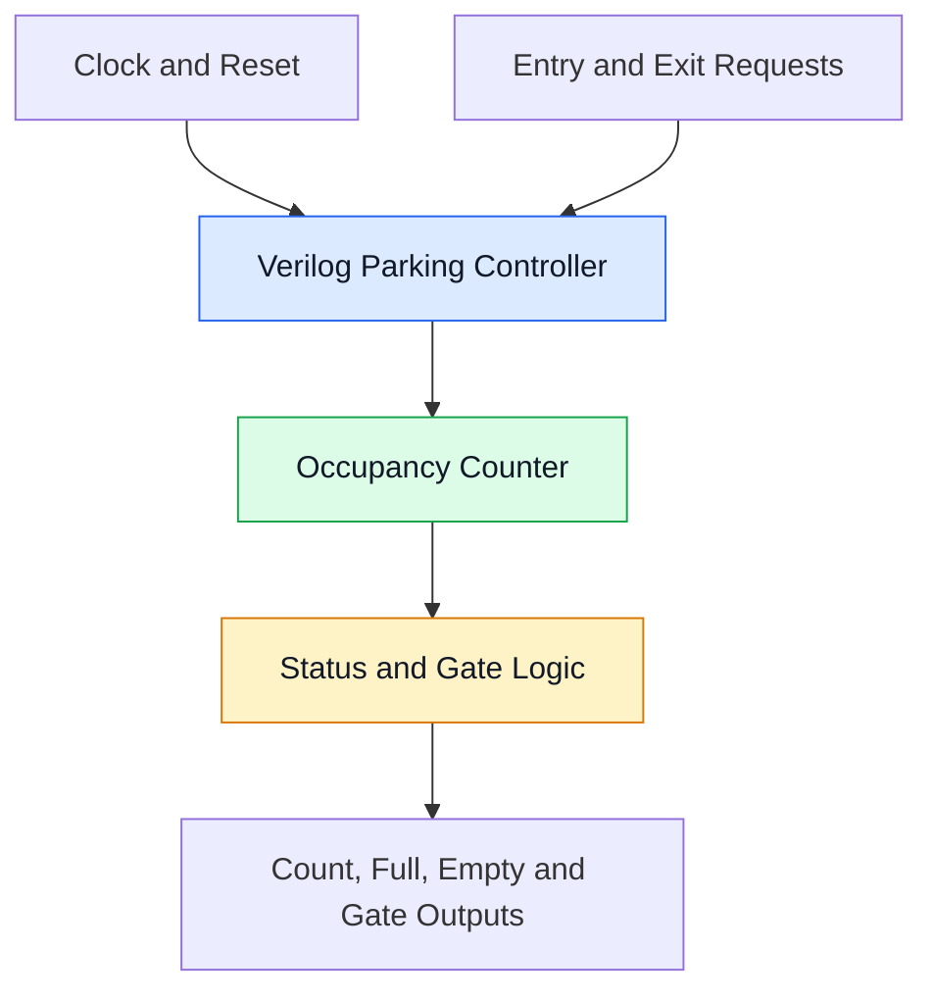
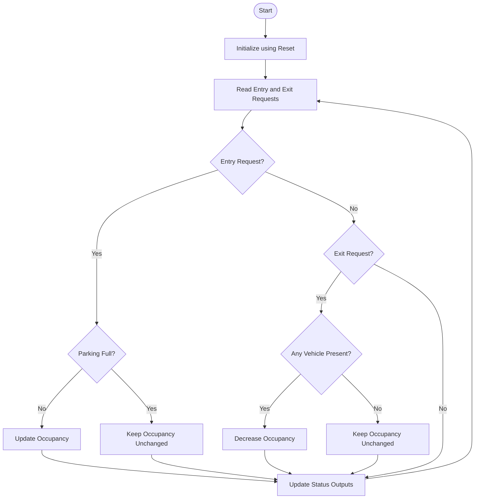
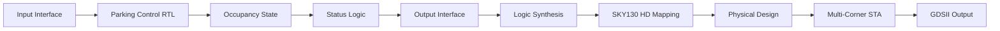

# 🚗 Four-Slot Smart Parking Occupancy and Gate Controller ASIC

  <b>A Verilog-Based Digital Controller Implemented Using the SKY130 ASIC Design Flow</b>

  
  
  
  

##  INTRODUCTION

Parking management is an important challenge in places such as offices, apartments, shopping centres, and educational institutions. Manual parking management can cause confusion about available spaces and delay vehicle entry.

This project presents a **Four-Slot Smart Parking Occupancy and Gate Controller ASIC** developed using Verilog HDL. The controller tracks parking occupancy for up to four slots and generates status and gate-control outputs based on entry and exit events.

The design is verified through simulation and taken through an open-source ASIC implementation flow using the SKY130 HD standard-cell library.

### 🌟 Project at a Glance

| 🅿️ Parking capacity | ⚙️ Digital design | 🔬 ASIC implementation |
|:--|:--|:--|
| Four parking slots | Verilog RTL | SKY130 HD |
| Entry and exit control | Functional simulation | Synthesis and physical design |
| Occupancy status | Static timing analysis | GDSII layout output |

## The Five W's

- **What:** A digital controller for four-slot parking occupancy and gate control.
- **Why:** To demonstrate automated occupancy tracking using digital hardware.
- **Where:** Intended for small parking facilities; physical sensors and gate drivers are future integration components unless separately implemented.
- **When:** The controller processes entry and exit requests according to its clocked RTL logic.
- **Who:** VLSI students, digital-design engineers, and parking-system designers.

## PROBLEM STATEMENT

Manual parking management makes it difficult to track available spaces consistently. A digital controller is needed to maintain the occupancy count, identify full and empty conditions, and generate appropriate control outputs.

The objective is to implement and verify a compact RTL design that handles these operations and can be evaluated through an ASIC implementation flow.

##  OBJECTIVES

- Design the parking controller using Verilog HDL.
- Track occupancy across four parking slots.
- Handle vehicle entry and exit requests.
- Generate parking status and gate-control outputs.
- Verify functionality using a testbench and waveforms.
- Perform logic synthesis and SKY130 technology mapping.
- Evaluate timing across TT, SS, and FF process corners.
- Document physical-design results and generated layout files.

## SYSTEM OVERVIEW

The controller accepts a clock, reset, entry request, and exit request. Its internal logic updates the occupancy state and produces the configured status outputs.

| Signal | Purpose |
|:--|:--|
| `clk` | Clock input |
| `reset` | Initializes controller state |
| `entry` | Vehicle-entry request |
| `exit` | Vehicle-exit request |
| `slot_count` | Current occupancy count |
| `full` | Indicates all four slots are occupied |
| `empty` | Indicates no slots are occupied |
| `gate_open` | Gate-control output |

> Confirm these signal names and behaviours against your final RTL before submission. Include `warning` only if it exists in your module.

##  BLOCK DIAGRAM

## FLOWCHART

*The diagrams describe the intended operation. Adjust request priority and simultaneous entry/exit behaviour to match the implemented RTL.*

## ALGORITHM

1. Wait for the active clock edge.
2. Initialize the occupancy state when reset is asserted.
3. Check incoming entry and exit requests.
4. Prevent occupancy from exceeding four slots.
5. Prevent occupancy from dropping below zero.
6. Update the occupancy state according to the implemented request priority.
7. Generate `full`, `empty`, `slot_count`, and `gate_open`.
8. Repeat for subsequent clock cycles.

## SYSTEM ARCHITECTURE

The design is organized into input handling, occupancy-control logic, status generation, and output logic. The RTL is then synthesized into standard cells and evaluated through physical design and static timing analysis.

# 🚗 Why I Chose This Project

## Four-Slot Smart Parking Occupancy and Gate Controller ASIC

  

## Why I Chose This Project

I chose the **Four-Slot Smart Parking Occupancy and Gate Controller ASIC** because I wanted to work on a real-world problem while gaining practical experience in VLSI design and ASIC implementation.

Parking management can become difficult when the availability of parking spaces is not monitored properly. My project demonstrates how digital logic can track occupancy, process vehicle entry and exit requests, and generate parking-status and gate-control outputs.

I also selected this project because it allows me to explore the complete digital ASIC workflow, from Verilog RTL design and functional verification to synthesis, physical design, and static timing analysis using the SKY130 HD standard-cell library.

## What Makes This Project Valuable?

| Area | What I Learn |
|---|---|
| 🌍 Real-world application | Understanding parking occupancy management |
| 💻 RTL design | Writing digital logic using Verilog HDL |
| 🧪 Verification | Testing functionality using simulation and testbenches |
| 🔧 ASIC synthesis | Converting RTL into a technology-mapped netlist |
| 🏗️ Physical design | Understanding floorplanning, placement, clock-tree synthesis, and routing |
| ⏱️ Timing analysis | Evaluating timing across TT, SS, and FF corners |
| 🎯 Career development | Building practical skills relevant to entry-level VLSI roles |

##  My Main Goal

My goal is to develop a functional digital controller, verify its behaviour, understand the ASIC implementation stages, and evaluate its timing performance. Through this project, I aim to strengthen my understanding of RTL design and physical design while building a project that I can explain confidently during technical interviews.

## 6. Project Outcome

The Four-Slot Smart Parking Occupancy and Gate Controller ASIC demonstrates the design and implementation of a digital parking controller using Verilog HDL and the SKY130 HD standard-cell library.

The project outcomes include:

- **Occupancy Management:** Tracks parking occupancy across four slots.
- **Entry and Exit Control:** Processes vehicle entry and exit requests according to the implemented RTL logic.
- **Status Generation:** Produces occupancy count, full, empty, and gate-control outputs.
- **Functional Verification:** Tests controller behaviour using simulation and a Verilog testbench.
- **Logic Synthesis:** Converts the RTL design into a technology-mapped standard-cell netlist.
- **Physical Design:** Demonstrates ASIC implementation stages, including floorplanning, placement, clock-tree synthesis, and routing.
- **Multi-Corner Timing Analysis:** Evaluates timing under TT, SS, and FF process corners using SKY130 timing libraries.
- **ASIC Layout Generation:** Produces a GDSII layout as part of the physical-design flow.

## Problem Solved

### 🔴 Before: Parking Availability Is Unclear

Manual parking management can make it difficult to identify available spaces and manage vehicle entry efficiently.

### 🟢 After: Digital Parking Occupancy Control

The Verilog-based controller tracks occupancy across four parking slots and generates status outputs, helping demonstrate a structured digital approach to parking management.

### ⚙️ Engineering Outcome

The design is simulated, synthesized, and evaluated through the SKY130 ASIC flow, including physical design and static timing analysis.

 

### Final Result

The project demonstrates an end-to-end digital ASIC design workflow, from RTL development and functional verification to physical design and static timing analysis. It provides practical experience in digital design and VLSI implementation that can be explained and demonstrated during technical interviews.

