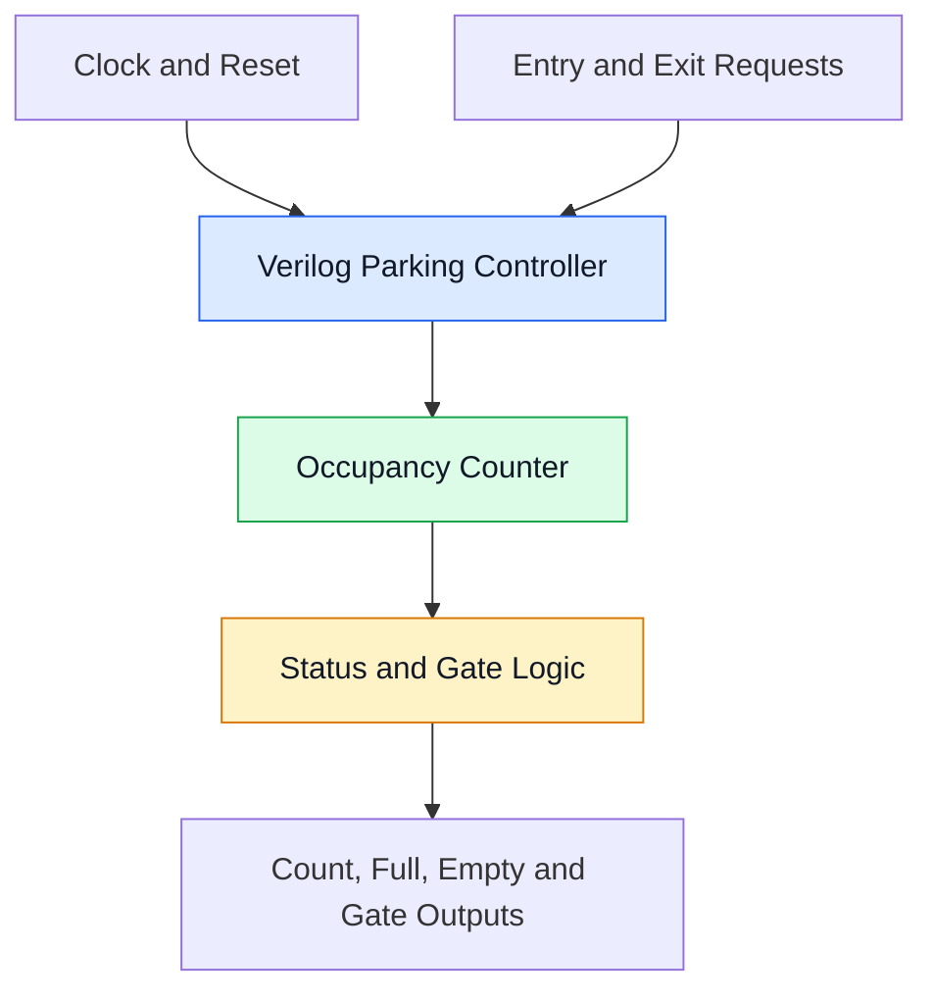
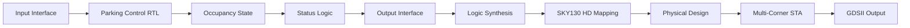

# 🚗 Four-Slot Smart Parking Occupancy and Gate Controller ASIC

  

  <b>A Verilog-Based Digital Controller Implemented Using the SKY130 ASIC Design Flow</b>

  
  
  
  

## 1.1 INTRODUCTION

Parking management is an important challenge in places such as offices, apartments, shopping centres, and educational institutions. Manual parking management can cause confusion about available spaces and delay vehicle entry.

This project presents a **Four-Slot Smart Parking Occupancy and Gate Controller ASIC** developed using Verilog HDL. The controller tracks parking occupancy for up to four slots and generates status and gate-control outputs based on entry and exit events.

The design is verified through simulation and taken through an open-source ASIC implementation flow using the SKY130 HD standard-cell library.

### 🌟 Project at a Glance

| 🅿️ Parking capacity | ⚙️ Digital design | 🔬 ASIC implementation |
|:--|:--|:--|
| Four parking slots | Verilog RTL | SKY130 HD |
| Entry and exit control | Functional simulation | Synthesis and physical design |
| Occupancy status | Static timing analysis | GDSII layout output |

## The Five W's

- **What:** A digital controller for four-slot parking occupancy and gate control.
- **Why:** To demonstrate automated occupancy tracking using digital hardware.
- **Where:** Intended for small parking facilities; physical sensors and gate drivers are future integration components unless separately implemented.
- **When:** The controller processes entry and exit requests according to its clocked RTL logic.
- **Who:** VLSI students, digital-design engineers, and parking-system designers.

## 1.2 PROBLEM STATEMENT

Manual parking management makes it difficult to track available spaces consistently. A digital controller is needed to maintain the occupancy count, identify full and empty conditions, and generate appropriate control outputs.

The objective is to implement and verify a compact RTL design that handles these operations and can be evaluated through an ASIC implementation flow.

## 1.3 OBJECTIVES

- Design the parking controller using Verilog HDL.
- Track occupancy across four parking slots.
- Handle vehicle entry and exit requests.
- Generate parking status and gate-control outputs.
- Verify functionality using a testbench and waveforms.
- Perform logic synthesis and SKY130 technology mapping.
- Evaluate timing across TT, SS, and FF process corners.
- Document physical-design results and generated layout files.

## 2.1 SYSTEM OVERVIEW

The controller accepts a clock, reset, entry request, and exit request. Its internal logic updates the occupancy state and produces the configured status outputs.

| Signal | Purpose |
|:--|:--|
| `clk` | Clock input |
| `reset` | Initializes controller state |
| `entry` | Vehicle-entry request |
| `exit` | Vehicle-exit request |
| `slot_count` | Current occupancy count |
| `full` | Indicates all four slots are occupied |
| `empty` | Indicates no slots are occupied |
| `gate_open` | Gate-control output |

> Confirm these signal names and behaviours against your final RTL before submission. Include `warning` only if it exists in your module.

## 2.2 BLOCK DIAGRAM

## 2.3 FLOWCHART

*The diagrams describe the intended operation. Adjust request priority and simultaneous entry/exit behaviour to match the implemented RTL.*

## 2.4 ALGORITHM

1. Wait for the active clock edge.
2. Initialize the occupancy state when reset is asserted.
3. Check incoming entry and exit requests.
4. Prevent occupancy from exceeding four slots.
5. Prevent occupancy from dropping below zero.
6. Update the occupancy state according to the implemented request priority.
7. Generate `full`, `empty`, `slot_count`, and `gate_open`.
8. Repeat for subsequent clock cycles.

## 2.5 SYSTEM ARCHITECTURE

The design is organized into input handling, occupancy-control logic, status generation, and output logic. The RTL is then synthesized into standard cells and evaluated through physical design and static timing analysis.

